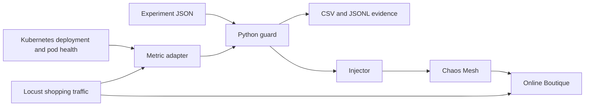

# Local chaos engineering setup: work completed, logs, and results

**Recorded:** 10 October 2026.  
**Workspace:** `/home/aashrith/Desktop/boschthon`.  
**Goal:** deploy Online Boutique locally, inject controlled failures, measure their effect, and provide a reliable execution and observation layer for a future AI chaos engineering agent.

This document records implementation work and the evidence inspected so far. It does not claim that every available experiment or planned agent has been verified.

## 1. Current status

- Online Boutique is deployed on a local kind cluster using rootless Podman. The user confirmed that shopping and adding items to the cart work.
- Chaos Mesh is installed and network delay injection has been confirmed from actual experiment status.
- Locust generates shopping traffic and writes console statistics and CSV files.
- The imported FantasticFour Python injector and guard have been adapted to the existing cluster.
- Two Python-controlled experiments were injected, triggered automatic rollback, and recovered: product catalog network delay and cart service pod failure.
- Lifecycle events, measured metrics, and available container logs are saved in CSV. Complete lifecycle records are also saved as JSONL.
- Fourteen offline behavior tests passed.
- The AI planning agents, Prometheus/Grafana integration, dependency mapping, resilience scoring, and Streamlit dashboard remain future work.

The successful verification summary is [runs/verification-20261010T062253.878389Z/summary.json](runs/verification-20261010T062253.878389Z/summary.json). Both experiments have `injected: true`, `recovered: true`, `breach_detected: true`, `passed: true`, and no log collection errors.

## 2. Local deployment

| Item | Configuration |
| --- | --- |
| Application | Google Cloud Online Boutique, release `v0.10.4` |
| Upstream checkout | `microservices-demo/`, commit `474d0f2eb73d97525234995a40d7781b7923a07d` |
| Host runtime | Rootless Podman; cgroup v2; Fedora host |
| kind | `v0.33.0` |
| Kubernetes node | `kindest/node:v1.37.0`, pinned by image digest in `deploy/kind.yaml` |
| Cluster/context | `online-boutique` / `kind-online-boutique` |
| Application namespace | `online-boutique` |
| Project kubeconfig | `.runtime/kubeconfig` |
| Storefront | `http://localhost:8080` |
| Exposure | Localhost port 8080 → kind node port 30080 → frontend service |
| Application replicas | Initially one replica per application deployment |
| Background load | Disabled by default; started explicitly for tests |

`scripts/deploy-local.sh` clones the pinned release, renders the Kustomize overlay, creates or reuses the cluster, applies the application, waits for deployment rollouts, and requests both `/` and `/cart` before reporting readiness.

The cluster runs in a delegated user systemd scope. `deploy/containers.conf` supplies a larger PID limit and the `k8s-file` Podman log driver for this invocation.

The deployment includes the ten business microservices, Redis cart storage, and the separately controlled Locust load generator. Payments and email are mock operations. Redis uses ephemeral storage; restarting its pod can lose cart data. That data-loss experiment has not been performed in this session.

## 3. Problems encountered and fixes

| Problem | Evidence and resolution |
| --- | --- |
| Docker, kind, and kubectl initially unavailable | Podman was already installed. kind and kubectl were installed from the host terminal, and kind was configured to use Podman. |
| kubectl segmentation fault | The downloaded ELF file was truncated. Added `scripts/install-kubectl.sh`, which verifies the download checksum and executes the binary before installing it. |
| HTTP/2 download failure | Changed the kubectl installer to HTTP/1.1 and added retries. |
| Unsupported `kubectl rollout status --all` | Changed deployment readiness checks to iterate over named deployments. |
| Cart returned a shipping connection error | Shipping was still downloading its image. Later pod status, listening-port logs, and EndpointSlice readiness confirmed it was available; the user then confirmed the cart worked. Added a cart readiness request. |
| Locust logs showed `PodInitializing` | The main container starts after image pulls and the `frontend-check` init container. Added `scripts/load.sh` to wait for readiness and display startup diagnostics. |
| Unclear traffic level from console logs | Enabled explicit console output and writable CSV statistics; added a counter sampler and real metric collection. |
| Chaos Mesh could not set iptables chains | `injectedCount` stayed zero. Loaded the missing host legacy iptables/ipset modules; the recreated shipping delay then reached `Injected`. |
| Imported code targeted the wrong environment | Replaced `boutique` and default-context access with `online-boutique` and explicit project kubeconfig/context. |
| Imported guard used zero-valued metric placeholders | Added a monitor that reads actual Locust CSV data and Kubernetes health. |
| Imported code treated resource creation as injection | Added status verification and separate `CREATED` / `INJECTED` events. |
| Imported cleanup and abort were too broad | Added cleanup around creation and observation, resource ownership checks, per-run identity, and an abort scoped to Python-owned experiments. |

This assistant session cannot open the local Kubernetes API socket or run the container runtime. Cluster commands were therefore executed from the user's host terminal. Early assistant attempts are retained as error evidence in `runs/`; they are not successful experiment runs.

## 4. Chaos Mesh configuration

Chaos Mesh chart **2.8.4** is installed in namespace `chaos-mesh`. The installer downloads checksum-verified Helm **v3.19.0** into `.runtime/tools/helm` and keeps Helm configuration/cache inside `.runtime/`.

The Chaos Mesh daemon uses **containerd inside the kind node**, at `/run/containerd/containerd.sock`. Podman runs the outer node container; it is not the socket used for the Kubernetes workloads.

Configuration in `chaos/values.yaml`:

- One controller replica, with leader election disabled for the local cluster.
- Namespace filtering enabled; `online-boutique` is annotated to allow injection.
- Local dashboard enabled with a ClusterIP service.
- Dashboard authentication disabled for development; access is through a localhost-only port-forward.
- Additional DNS chaos server disabled.

Network experiments required these host modules:

```bash
sudo modprobe -a ip_tables iptable_filter iptable_mangle ip_set ip_set_hash_ip xt_set sch_netem
```

These commands load modules for the running kernel; no persistent boot-time module configuration was added.

### Available shell experiments

| Experiment | Type/effect | Requested duration | Evidence so far |
| --- | --- | --- | --- |
| `shipping-delay` | Network delay: 250 ms with 50 ms jitter | 60 seconds | Injection confirmed from host-terminal status |
| `shipping-kill` | Deletes one shipping pod | One deletion | Manifest prepared; live execution not confirmed here |
| `currency-cpu` | CPU stress: one worker, load 80 | 60 seconds | Manifest prepared; live execution not confirmed here |
| `checkout-partition` | Blocks traffic between frontend and checkout | 45 seconds | Manifest prepared; live execution not confirmed here |

`scripts/chaos.sh` creates, shows, deletes, or lists these resources and opens the dashboard. Its `stop-all` command removes resources labeled `app.kubernetes.io/part-of=boutique-chaos`. Python-created resources use a different ownership label and are stopped with the Python abort command.

## 5. Request traffic and metric definitions

Locust uses the upstream shopping tasks: browsing products, changing currency, adding items, viewing carts, and mock checkout. Each simulated user waits **1–10 seconds between tasks**.

`USERS` is the target number of concurrent shoppers. `RATE` is the rate at which new shoppers start, in users per second. Neither value directly specifies requests per second.

`chaos/loadgenerator-observability.yaml` patches the existing Deployment to print statistics explicitly and write CSV files into a writable `/stats` volume. That volume is ephemeral: export statistics before replacing the load-generator pod.

| Metric | Meaning |
| --- | --- |
| `users` | Actual active users reported by Locust history |
| `requests` | Cumulative completed request count, including requests that failed |
| `failures` | Cumulative failed request count |
| `rps` | Recent completed requests per second from Locust history |
| `error_rate` | Recent failed requests per second divided by recent completed RPS; `0.20` means 20% |
| `p95_ms` | Recent 95th-percentile request latency in milliseconds |
| `checkout_success` | Cumulative successful-checkout fraction for the current Locust process; blank/null until a checkout completes |
| `unhealthy_services` | Deployments with desired replicas above zero and fewer ready replicas than desired |
| `restarts` | Sum of current pods' container restart counters, grouped by service label |
| `metrics_age_s` | Age of the most recent Locust aggregate history record |

**p95 example:** p95 of 3,500 ms means approximately 95% of requests completed in 3.5 seconds or less, and the slowest 5% took longer. It is not the average latency. Locust reports rounded percentile estimates.

The Python monitor reads the history configured with `--csv-full-history` for recent percentile samples. It rejects stale statistics, absent users, missing request data, and zero completed RPS instead of substituting healthy-looking zeros. The standalone `scripts/measure-load.py` sampler displays cumulative-run p95 and computes interval RPS from counter differences; its p95 has a different time scope from the guard's recent p95.

Increasing users raises offered traffic. Chaos increases failure conditions or resource pressure; it can reduce achieved RPS by slowing requests. A higher latency during chaos is not proof that traffic volume increased.

## 6. Repository import and compatibility

The code from [Gotha8972/FantasticFour](https://github.com/Gotha8972/FantasticFour) was brought into the existing workspace, preserving the running platform's `.runtime/` state and upstream application checkout. Overwritten local files were backed up under `.runtime/import-backups/`. Repository Git metadata was excluded from the import.

Reviewed the imported `PLAN.md`, `DAY1.md`, and `C_INJECTION_KILLSWITCH.md`, plus the local documentation, original injector/guard/tests, setup script, and experiment definitions. Detailed findings are in [COMPATIBILITY.md](COMPATIBILITY.md).

The plan matches the intended architecture: an AI planner proposes experiments, a deterministic operator injects faults, a deterministic guard limits damage, and an observer/analyst records outcomes. Only the operator, guard, metric adapter, and evidence collection are implemented here.

The original `setup/sandbox.sh` assumes an Ubuntu/Docker environment, creates a different cluster and namespace, and installs Prometheus/Grafana. It has not been run on this Fedora setup. Use the local scripts documented below.

## 7. What the Python guard does

The guard in `chaosmind/guard.py` is deterministic Python code. It runs the experiment and decides when to ask Chaos Mesh to remove it.



1. Validate fault, target, namespace, parameters, and duration.
2. Refuse overlap with unrecovered chaos resources or an unhealthy baseline.
3. Create a Chaos Mesh resource and wait for actual injection evidence.
4. Monitor real request metrics and deployment health.
5. On a breach, planned end, monitoring/injection error, or Ctrl-C, request deletion of the owned resource.
6. Wait for deployment health and request metrics to return within thresholds.

| Guard setting | Default |
| --- | --- |
| Error fraction | Stop when above `0.20` |
| p95 latency | Stop when above `2000` ms |
| Unhealthy deployments | Stop when more than `2` |
| Maximum experiment duration | `120` seconds |
| Poll interval | `2` seconds, plus API/collection time |
| Injection confirmation timeout | Up to `60` seconds, bounded by the requested experiment duration |
| Recovery observation timeout | `120` seconds |

Threshold overrides may tighten the damage limits, not loosen them. Each continuous fault also carries a Chaos Mesh duration. Automatic recovery still depends on a functioning controller/daemon; process cleanup cannot handle a forced `kill -9`. The Chaos Mesh duration is the fallback in that case, but a kill-9 recovery test has not been performed here.

Deleting a fault resource requests restoration of the injected state. It does not guarantee that the app is already healthy. That is why `REVERTED` and `HEALTHY` are separate events.

## 8. File and script inventory

| Path | Purpose |
| --- | --- |
| `deploy/kind.yaml` | Cluster, node image, and localhost storefront port mapping |
| `deploy/containers.conf` | Podman PID/logging overrides |
| `deploy/kustomization.yaml`, `deploy/namespace.yaml` | Application namespace, frontend NodePort, and disabled default load |
| `scripts/install-kubectl.sh` | Verified kubectl download/install |
| `scripts/deploy-local.sh` | Deploy and check the local application |
| `scripts/install-chaos.sh` | Install Helm locally and Chaos Mesh; validate schemas without starting faults |
| `scripts/chaos.sh` | Shell experiment lifecycle and dashboard access |
| `scripts/load.sh` | Start/stop load, startup diagnostics, sample counters, export raw Locust CSV |
| `scripts/measure-load.py` | In-container live counter sampler |
| `chaos/experiments/*.yaml` | Four shell-accessible Chaos Mesh experiments |
| `experiments/test-delay.json` | Guarded 500 ms product catalog delay, requested for 60 seconds |
| `experiments/test-down.json` | Guarded cart service pod failure, requested for 60 seconds |
| `chaosmind/inject.py` | Manifest generation, validation, create/status/revert, scoped abort |
| `chaosmind/monitor.py` | Real request metrics and Kubernetes health adapter |
| `chaosmind/guard.py` | Preflight, injection confirmation, threshold monitoring, cleanup, recovery |
| `chaosmind/runlog.py` | Immediate lifecycle/metric CSV and JSONL writing |
| `chaosmind/capture.py` | Independent metrics, pod-log CSV export, JSONL-to-CSV conversion |
| `chaosmind/verify.py` | Sequential real experiment verification and evidence collection |
| `chaosmind/test_guard.py` | Fourteen offline behavior tests |

## 9. How to read every log type

### Verification directories

`runs/verification-<UTC timestamp>/` contains:

- `baseline.json`: actual metric snapshot taken before verification.
- `summary.json`: admission result for dry runs, or per-experiment injection/recovery/breach/pass status for live runs. Connection failures are recorded as errors.

`passed: true` means the verification workflow confirmed injection, a permitted end/rollback, and recovery. It does **not** mean the application suffered no disruption or that a resilience score has been calculated.

### Experiment directories

`runs/<experiment-id>-<UTC timestamp>/` contains the following evidence:

| File | Contents |
| --- | --- |
| `events.csv` | Lifecycle events and snapshot rows |
| `metrics.csv` | Only the snapshot rows, suitable for plotting metrics over time |
| `events.jsonl` | Complete structured event records, one JSON object per line |
| `loadgenerator-logs.csv` | Locust console statistics and available messages |
| `frontend-logs.csv` | Available frontend request/application messages |
| `target-logs.csv` | Available target-service messages |
| `chaos-daemon-logs.csv` | Available daemon messages about fault application/recovery |

`events.csv` and `metrics.csv` share these columns:

```text
timestamp_utc, t, event, experiment_id, fault, target, reason,
metric, value, limit, recovery_s, users, rps, requests, failures,
error_rate, p95_ms, checkout_success, unhealthy_services, restarts,
details_json
```

- `timestamp_utc` is an absolute UTC timestamp. Add 5 hours 30 minutes to display it in India time.
- `t` is elapsed seconds from **guard-run start**, including preflight. It is not elapsed time since fault injection.
- `metric`, `value`, and `limit` explain a threshold breach.
- `recovery_s` measures from rollback request to the first confirmed healthy snapshot. It includes cleanup and observation delays, including the recent-metrics window; it is not a precise container restart duration.
- `unhealthy_services` and `restarts` are JSON strings inside CSV cells.
- `details_json` preserves additional fields such as snapshot `stage`, metric source, and injection records. CSV quotes/commas are escaped by Python's CSV writer.
- Blank cells mean that a field does not apply to that event; they do not imply a zero measurement.

### Lifecycle events

| Event | Meaning |
| --- | --- |
| `SNAPSHOT` | Real metric/health sample; stage is preflight, injecting, injected, or recovery |
| `REFUSED` | Preflight prevented injection |
| `CREATED` | Kubernetes accepted the resource; injection is not yet proven |
| `INJECTED` | Chaos Mesh confirmed injection through conditions or container records |
| `BREACH` | A monitored value exceeded its threshold |
| `ENDED` | The requested experiment duration elapsed without an earlier breach |
| `REVERT_REQUESTED` | Cleanup is beginning |
| `REVERTED` | Owned resource deletion completed |
| `HEALTHY` | Deployment health and request metrics satisfy recovery checks |
| `ERROR` | Injection, monitoring, or another operation failed |
| `REVERT_FAILED` | Cleanup did not complete successfully; investigate before another run |
| `MONITOR_ERROR` | Recovery metrics could not be collected for that poll |
| `NOT_RECOVERED` | Health was not confirmed before the recovery deadline |
| `INTERRUPTED` | Ctrl-C interrupted execution or recovery observation |

### Container-log CSV format

```text
collected_at_utc, timestamp_utc, namespace, pod, container,
message, collection_error
```

`collected_at_utc` is when the exporter retrieved logs. `timestamp_utc` is the Kubernetes timestamp attached to each log line. `message` contains the line itself, including embedded JSON when the application uses structured logging.

These are snapshots of the selected pods' available recent logs, not persistent centralized logging. The default lookback is ten minutes, so exports from sequential experiments overlap. Do not sum their rows as distinct requests or treat all rows as belonging to that experiment's fault window. Use timestamps and lifecycle events to select the relevant period. Deleted pods' older logs may be unavailable.

### Other CSV/text files

- `.runtime/load-reports/sample-*.txt`: readable output of the live counter sampler.
- `.runtime/load-reports/csv-*/load_stats.csv`: cumulative Locust endpoint/aggregate statistics.
- `load_stats_history.csv` in the same export: time-series request rate, failures, users, percentiles, and totals.
- `load_failures.csv` in the same export: grouped Locust failure descriptions and occurrence counts.
- `runs/session-metrics-attempt.csv`: an error record from this assistant session's blocked metric collection attempt.
- `converted-events.csv`: demonstration export of an existing JSONL file; not an additional experiment.

`runs/`, `.runtime/`, the upstream application checkout, Python cache directories, and `.env` are git-ignored. Evidence should be copied into deliberate submission artifacts if it must be shared or committed.

## 10. Actual verified results

The successful live verification started at approximately **06:22:53 UTC / 11:52:53 IST** on 10 October 2026.

Its saved baseline had **20 users**, **4.2 RPS**, **0% errors**, **56 ms p95**, and no unhealthy deployments. Checkout success was 100% for the checkouts already completed in that Locust process.

### Product catalog delay

Artifacts: [runs/test-delay-20261010T062255.501508Z/](runs/test-delay-20261010T062255.501508Z/events.csv).

| Event | Elapsed seconds from guard start |
| --- | ---: |
| Resource created | 1.514 |
| Injection confirmed | 4.631 |
| p95 breach at 3,500 ms, threshold 2,000 ms | 7.832 |
| Rollback requested | 7.832 |
| Resource deletion completed | 8.160 |
| Health confirmed | 22.622 |

Measured recovery after rollback request: **14.791 seconds**. Rollback deletion completed about **0.328 seconds** after the request. The recorded p95 peaked at **4,100 ms** during observation. No request errors appeared in the sampled aggregate error fractions.

Ten metric samples kept 20 users active. RPS ranged from **2.7 to 5.3**, and cumulative request count increased from **139 to 224**.

### Cart service pod failure

Artifacts: [runs/test-down-20261010T062320.861245Z/](runs/test-down-20261010T062320.861245Z/events.csv).

| Event | Elapsed seconds from guard start |
| --- | ---: |
| Resource created | 1.471 |
| Injection confirmed | 1.618 |
| Error-rate breach at 34.8837%, threshold 20% | 8.101 |
| Rollback requested | 8.102 |
| Resource deletion completed | 8.481 |
| Health confirmed | 63.565 |

Measured recovery after rollback request: **55.463 seconds**. Rollback deletion completed about **0.379 seconds** after the request. The sampled error fraction peaked at **100%** during one recent window; that does not mean every request in the entire run failed. The sampled p95 reached **2,700 ms**. `cartservice` was observed as unhealthy.

Twenty-four metric samples kept 20 users active. RPS ranged from **3.4 to 5.3**, and cumulative request count increased from **239 to 506**.

**Qualification:** the pod-failure test tightened `max_unhealthy` to zero, but the first reported breach was error rate. Breach checks examine error rate before latency and deployment health. This run demonstrates error-triggered rollback; it does not independently prove rollback triggered specifically by pod health. The verifier currently accepts any detected breach for this test.

### Saved CSV counts

| CSV | Product catalog delay | Cart pod failure |
| --- | ---: | ---: |
| Lifecycle/snapshot rows in `events.csv` | 16 | 30 |
| Metric rows in `metrics.csv` | 10 | 24 |
| Locust log lines | 465 | 1,092 |
| Frontend log lines | 22,651 | 23,898 |
| Target-service log lines | 0 | 111 |
| Chaos daemon log lines | 31 | 31 |

No collection errors were recorded in these live exports. The delay target's CSV contains only a header: the selected service returned no available messages for the requested lookback. Its empty log file is not evidence of failed injection; the status and lifecycle records confirmed injection.

### Earlier directories

| Directory/file | Interpretation |
| --- | --- |
| `test-delay-20261010T061933.677285Z/` | Assistant API access denied; no injection and no metric samples |
| `test-down-20261010T061934.137854Z/` | Assistant API access denied; no injection and no metric samples |
| `verification-20261010T061934.597616Z/` | Blocked verification attempt |
| `verification-20261010T062251.653970Z/` | Successful server dry run for both manifests; deliberately no injections |
| `verification-20261010T062253.878389Z/` | Successful live verification of both experiments |

## 11. Commands for another run

Run these from the workspace in a normal host terminal.

```bash
cd /home/aashrith/Desktop/boschthon

# Start request traffic and inspect counters.
bash scripts/load.sh start 20 2
bash scripts/load.sh measure 5 30

# Check baseline and admission without creating faults.
python3 -m chaosmind.verify --dry-run

# Run the imported experiments sequentially and save evidence.
python3 -m chaosmind.verify
```

The verifier requires fresh traffic and a healthy baseline. It stops after a failed experiment instead of continuing. Do not run another fault simultaneously.

Useful independent captures, choosing fresh output filenames each time:

```bash
python3 -m chaosmind.capture metrics --duration 60 --interval 2 \
  --phase baseline --output runs/new-baseline.csv

python3 -m chaosmind.capture logs --selector app=loadgenerator \
  --output runs/new-locust-logs.csv

python3 -m chaosmind.capture logs --namespace chaos-mesh \
  --selector app.kubernetes.io/component=chaos-daemon \
  --output runs/new-daemon-logs.csv
```

Collectors refuse to overwrite an existing output file. Export raw Locust statistics with `bash scripts/load.sh export` before restarting its pod.

Dashboard and cleanup:

```bash
bash scripts/chaos.sh dashboard          # http://localhost:2333
python3 -m chaosmind.inject abort        # Python-owned faults
bash scripts/chaos.sh stop-all           # Supplied shell/YAML faults
bash scripts/load.sh stop               # Stop request traffic
```

Dashboard-created experiments must be stopped independently unless they carry one of those ownership labels. Do not remove cleanup finalizers to force deletion of a failed experiment.

## 12. Validation and remaining work

The original small offline checks passed before adaptation. The expanded suite, `python3 -m chaosmind.test_guard`, passed fourteen tests covering breach rollback, unhealthy/overlapping preflight refusal, monitor failures, creation failure cleanup, failed-injection detection, Ctrl-C, threshold tightening, scope/parameter validation, resource ownership, real metric parsing, and CSV escaping.

Those tests simulate cluster responses. The live run summaries provide the separate evidence that the product catalog delay and cart pod failure actually worked on this host.

Remaining work to fulfill the larger plan:

1. Implement dependency mapping and the AI experiment planner, Safety Officer, Observer, and Analyst.
2. Add Prometheus or another source for CPU/memory utilization and per-service metrics; current evidence is request-level Locust data plus Kubernetes health.
3. Independently verify the pod-health rollback trigger, CPU stress, network partition, pod deletion, and forced-guard-exit duration fallback.
4. Collect longer steady-load baselines and repeat experiments to measure variability.
5. Run a controlled user-count comparison to verify how throughput and latency change at higher offered load; the inspected successful runs both used 20 users.
6. Perform the Redis cart-persistence experiment with before/after evidence.
7. Define resilience scoring and build findings/fix reports, then rerun after a chosen fix.
8. Run the complete documented setup on another machine before submission.

Further instructions: [README.md](README.md), [chaos/README.md](chaos/README.md), and [COMPATIBILITY.md](COMPATIBILITY.md).

## 13. Later monitoring and pod kill results

Prometheus/Grafana monitoring and a single catalog pod kill demonstration were
added after the original handoff above. The October 10 run confirmed one kill,
replacement availability in approximately 3 seconds, and request metrics
returning within approved limits after approximately 34 seconds. The captured
session recorded 68 HTTP 500 failures, including two before injection; checkout
had 16 failures out of 179 requests and a whole-session p95 of 12 seconds.

See [the monitoring results and evidence](monitoring/README.md#recorded-pod-kill-results--october-10-2026)
for the complete timeline, affected operations, recovery measurements, and
limits on interpreting the saved logs.
