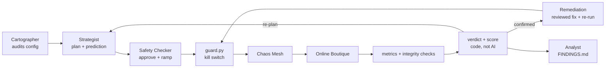

# FantasticFour: AI-Driven Chaos Engineering for Cloud-Native Resilience

> Bosch Hackathon 2026. An AI system that **audits** a microservices app for weak spots, **plans** experiments with predictions, **breaks things safely** behind a deterministic kill switch, catches **silent failures**, **scores** resilience, and **proves fixes** by re-running the same experiment.

**One-page architecture:** [docs/ARCHITECTURE.md](docs/ARCHITECTURE.md) · **Setup and how to run:** [docs/RUNNING.md](docs/RUNNING.md) · **Agents in detail:** [docs/AGENTS.md](docs/AGENTS.md)

---

## The problem
Modern apps are dozens of small services calling each other. When one fails, nobody knows in advance what else breaks, how users are affected, or how long recovery takes. **Chaos engineering** finds out first by injecting controlled failures. Doing it by hand is slow and unfocused, so our system automates the loop: **audit → hypothesise → inject safely → judge → fix → re-test → report**.

## How it works



| Component | Kind | Status |
|---|---|---|
| **Cartographer**: ranks architecture vulnerabilities; every cited fact verified against the real config | AI + code | ✅ built, offline-tested |
| **Strategist**: experiment + prediction + pass/fail criteria written *before* the run; re-plans after each result | AI + code | ✅ built, offline-tested |
| **Safety Checker**: approve / shrink / reject (can only make experiments smaller); ramps intensity through the guard | AI + code | ✅ built, offline-tested |
| **Integrity checks**: did the cart survive? did checkout really create an order? | Code | ✅ built, offline-tested |
| **Resilience score**: 0–100 from error, latency, recovery and integrity impact ([formula](chaosmind/agents/score.py)) | Code | ✅ built |
| **Remediation**: picks a fix from a reviewed catalog, applies it after a dry run, re-runs, keeps it only if the score improves | AI + code | ✅ built, offline-tested |
| **Analyst**: root cause from logs (quotes verified), writes a fact-checked `FINDINGS.md` | AI + code | ✅ built, offline-tested |
| **Injector + kill switch** (`inject.py`, `guard.py`) | Code | ✅ **proven live** |

**First real AI run** ([dry run, 10 Oct](runs/agents-20261010T104327Z/README.md), no faults injected): the Cartographer ranked 8 vulnerabilities with **0 rejected for unverifiable evidence** (and noticed the new Redis PVC, flagging availability rather than data loss); the Strategist produced 4 validated experiments with pre-registered criteria; the Safety Checker approved the first. Learning from it, we added a severity rubric (the frontend entrypoint is critical), a rule requiring different fault types per plan, and code that drops criteria which prove nothing (e.g. "target unhealthy" after killing that target).
| **Grafana dashboard** (Prometheus, kube-state-metrics, Locust/Chaos exporters) | Platform | ✅ running |

**Design rule:** AI agents only return JSON. **No agent touches the cluster**; deterministic code validates every decision, and the kill switch can't be loosened by any agent. AI model: OpenAI `gpt-5.6-luna` (low reasoning effort) via the chat completions API in JSON mode.

## Target application and dependency map

[Google Online Boutique](https://github.com/GoogleCloudPlatform/microservices-demo) (Apache-2.0), release `v0.10.4`: an e-commerce demo with 10 business services in 5 languages, communicating over gRPC, plus Redis.


Based on Google's architecture diagram and **checked against the deployment manifest**. Every `*_ADDR` environment variable is a service-to-service call, and all 17 edges match:

| Caller | Calls |
| :--- | :--- |
| loadgenerator | frontend |
| frontend | ad, recommendation, productcatalog, cart, shipping, currency, checkout |
| checkout | productcatalog, cart, shipping, currency, payment, email |
| recommendation | productcatalog |
| cart | redis-cart |

*Manual correction:* upstream `main` also gives `frontend` an optional `SHOPPING_ASSISTANT_SERVICE_ADDR`. It isn't in our deployed release, so it's excluded.

**What the map predicts:**
- `productcatalog` has the most callers, so it has the widest blast radius.
- `checkout` depends on 6 services, so it's the most fragile path.
- `redis-cart` is a single store behind `cart`, so it's a data-loss risk.
- `ad` and `recommendation` are optional, so they should degrade gracefully.

---


## Safety controls (all tested live, except where noted)
- **Validation:** 7 known fault types, real targets, namespace `online-boutique` only, duration ≤ 120 s, intensity caps.
- **Pre-flight:** refuses to inject into an unhealthy app or while another fault is active.
- **Kill switch:** polls every 2 s; reverts on **error rate > 5%**, **p95 > 1,000 ms** or **> 2 unhealthy services**. Revert takes ~0.3–0.4 s. Moderate error spikes must persist 2 polls, to avoid false trips from background noise (offline-tested).
- **Fail-safe:** every fault carries Chaos Mesh's own `duration`, so it ends even when the guard is killed with `kill -9`.
- **Always revert** on errors and Ctrl-C; **scoped manual abort**; runtime limits can only be **tightened**.
- **Honest limit:** breaches are detected ~6–10 s after injection, because Locust reports a rolling ~10 s window.

## Results so far

**Steady-state baselines** (20 shoppers, no faults):

| Study | Samples | Req/s | Errors | p50 / p95 (mean) | Checkout success | Unhealthy / restarts |
|---|---|---|---|---|---|---|
| [15 min, before monitoring](docs/evidence/BASELINE_STUDY.md) | 181 | 4.37 | 0.05% (2 / 3,933) | 20 ms / 78 ms | 98.8% (166/168) | 0 / 0 |
| [5 min, with monitoring](runs/baseline-study-20261010T093022.185681Z/BASELINE_RESULTS.md) → [`baseline.json`](baseline.json), used by the agents | 62 | 4.55 | 0.07% (1 / 1,372) | 11 ms / 35 ms | 98.6% (68/69) | 0 / 0 |

Each experiment is compared with the baseline taken under the same conditions, not with zero.

**Kill-switch limits:** the runs below up to the catalog pod kill used the original limits (**20% errors / 2,000 ms p95**). The team then tightened them to **5% / 1,000 ms**, which the 100-shopper catalog-delay runs used and which are the current defaults.

| Experiment | What happened | Kill switch | Recovery |
|---|---|---|---|
| 500 ms delay on `productcatalogservice` | p95 rose to 3,500 ms (peak 4,100 ms); no errors | Breach on **p95** at 7.8 s, reverted in 0.33 s | 14.8 s |
| `cartservice` unavailable | Error rate 35% (peak 100% in one window), p95 2,700 ms | Breach on **error rate** at 8.1 s, reverted in 0.38 s | 55.5 s |
| `adservice` unavailable | **0% errors**, the frontend degrades gracefully | Breach on **unhealthy service** at 9.2 s, reverted in 0.38 s | 36.1 s |
| Guard killed with `kill -9` mid-fault | Fault still ended via Chaos Mesh's duration | Fail-safe ✅ | — |
| Manual abort with 2 active faults | Both removed in 0.39 s | ✅ | — |
| `productcatalogservice` pod killed (**100 shoppers**) | Replacement pod available in ~3 s, but **66 HTTP 500s**, checkout 16/179 failed (8.9%), peak error rate 25.6%, peak p95 10 s | One-shot kill (no revert possible); preflight + recovery checks | Customers back to normal after **~34 s** |
| 500 ms delay on `productcatalogservice` (**100 shoppers**), run twice | p95 **4,300 / 4,400 ms**, almost no errors | Breach on **p95** at 9.6 s both times (limit 1,000 ms), reverted in 0.30–0.32 s | **14.1 / 14.0 s**, reproducible |
| `redis-cart` pod restarted | **Cart emptied (1 item → 0) with zero HTTP errors**: silent data loss | — | 4.9 s |
| `redis-cart` pod restarted **after the fix** (PVC + append-only log) | **Cart kept (1 item → 1)**, 0 HTTP errors | — | 3.3 s |

**Findings so far** (most severe first)

1. 🔴 **Silent cart data loss: fixed and re-tested ✅.** `redis-cart` ran as 1 replica on an `emptyDir` volume, so a restart wiped every cart while the site still returned HTTP 200. Redis did save on shutdown, but into a folder deleted with the pod. **Fix:** `bash scripts/redis-fix.sh apply` moves `/data` to a PersistentVolumeClaim, turns on the append-only log and uses the `Recreate` strategy. **Re-test:** same experiment, cart **1 → 1** after the fix (was **1 → 0**), 0 failed requests, back in 3.3 s ([before/after](docs/evidence/REDIS_FIX_RESULTS.md)). Still to prove: an instant kill (only the append-only log protects that). Trade-off: still 1 replica, so carts are briefly unavailable during a restart, but no longer lost.
2. 🟠 **Cart outage takes the shop down hard.** Losing `cartservice` drives error rate to 35–100% and takes ~55 s to recover. *Fix:* more replicas plus a PodDisruptionBudget; degrade the cart page instead of failing.
3. 🟠 **"Healthy" ≠ recovered.** After a catalog pod kill, Kubernetes reported the service available in ~3 s, but customers kept getting errors and 10 s responses for ~30 s more. Health checks alone would have hidden it. *Fix:* more than 1 replica so a single kill isn't an outage; readiness that reflects real serving capacity; client retries with backoff in the frontend.
4. 🟡 **Catalog latency spreads everywhere.** 500 ms on one service pushes site-wide p95 to 3.5 s at 20 shoppers and 4.4 s at 100, reproducibly, consistent with it having the most callers. *Fix:* client-side timeouts and caching of catalog reads in the frontend.
5. 🟡 **Checkout fails ~1.3% of the time with nothing broken.** 3 HTTP 500s in 237 checkouts across both baselines, always `POST /cart/checkout`. We ruled out the two obvious causes in the load generator's source (expired cards: the expiry is always in the future; invalid card numbers: Faker's `visa` is always a valid 16-digit Visa). The root cause needs payment/checkout logs captured right after a baseline, which is the Analyst's next case.
6. 🟢 **Ads fail gracefully**, as the map predicted.

*Load note:* the pod-kill and second catalog-delay runs used 100 shoppers; the baselines and other guarded runs used 20. Compare numbers within the same load level only.

Full evidence: [`docs/evidence/`](docs/evidence/) (kill-switch results, platform handoff, baseline study) and the `runs/` directory.

---


## Quick start
Full instructions: [docs/RUNNING.md](docs/RUNNING.md). In short (Linux, rootless Podman, kind):
```bash
bash scripts/deploy-local.sh && bash scripts/install-chaos.sh && bash scripts/load.sh start 20 2
```
```bash
python3 -m chaosmind.guard experiments/test-delay.json
```
```bash
python3 -m chaosmind.agents --dry-run
```
Offline tests (no cluster, no API key):
```bash
python3 -m chaosmind.test_guard && python3 -m unittest chaosmind.agents.test_agents chaosmind.agents.test_day2 chaosmind.test_c_tests
```

## Repository layout
```
chaosmind/            inject.py · guard.py (kill switch) · monitor.py · baseline.py · verify.py · c_tests.py
chaosmind/agents/     cartographer · strategist · safety · remediation · analyst · integrity · score · loop (__main__)
experiments/          one experiment JSON per failure type in the brief
remediation/          reviewed fix catalog (Redis persistence, replicas) + scripts/redis-fix.sh
scripts/ deploy/ chaos/ monitoring/   cluster, Chaos Mesh, load and Prometheus/Grafana setup
runs/                 evidence from every run (CSV + JSONL)
docs/                 architecture, running guide, agents, evidence reports, team notes
```

## Team, tools and models
**Team FantasticFour**

| Member | Contribution |
|---|---|
| Aashrith | Platform: kind/Podman cluster, Chaos Mesh, Prometheus/Grafana, baselines, every live verification run |
| Srinavith | Fault injection and kill-switch design; AI agents (Cartographer, Strategist, Safety Checker, Remediation, Analyst); integrity checks and score |
| Harshil | Customer simulator; Day 2: live integrity-check validation, demo video |
| Smrithi | Day 2: prompt tuning on live AI output, architecture overview, clean setup on a second machine |

**Third-party software:** Online Boutique v0.10.4 (Apache-2.0), kind, Podman, Kubernetes, Chaos Mesh 2.8.4, Helm 3.19, Locust (bundled load generator), kube-prometheus-stack 92.3.0, Python `requests` and `prometheus_client` (simulator only). The agents use only the Python standard library.
**AI models:** OpenAI `gpt-5.6-luna` (low reasoning effort), chat completions API in JSON mode. Configurable with `OPENAI_MODEL`.
**Data:** synthetic only: simulated shoppers and the app's built-in demo products.

Team task guides: [docs/team/](docs/team/GUIDE_00_EVERYONE.md).
