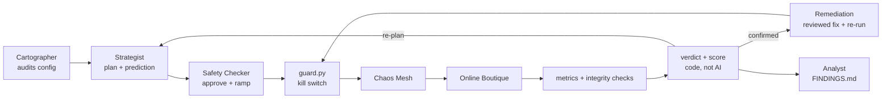

# FantasticFour: AI-Driven Chaos Engineering for Cloud-Native Resilience

> **Bosch Hackathon 2026.** An AI that **audits** a microservices system for weak spots, **plans** experiments with predictions, **breaks things safely** behind a deterministic kill switch, catches **silent failures** that monitoring misses, **scores** resilience and **proves fixes** by re-running the same experiment.

**Architecture (1 page):** [docs/ARCHITECTURE.md](docs/ARCHITECTURE.md) · **Run it:** [docs/RUNNING.md](docs/RUNNING.md) · **Agents:** [docs/AGENTS.md](docs/AGENTS.md)

## Highlights
| | |
|---|---|
| 🔍 **Found a silent data-loss bug, then fixed it** | Restarting Redis emptied shoppers' carts with **zero HTTP errors**; error-rate monitoring alone would never notice. Our integrity checks caught it, and our fix made the cart survive the same experiment (**1 → 0 before, 1 → 1 after**). |
| 🛑 **Kill switch: detects in ~8–10 s, reverts in ~0.3 s** | Every experiment runs under a guard that polls every 2 s and reverts automatically on error rate, latency or service-health breaches. Proven live on all three triggers, plus a crash fail-safe (`kill -9` on the guard) and manual abort. |
| 🧠 **AI that can't hallucinate its way into the cluster** | Agents only return JSON. Code verifies every cited fact (**0 unverifiable claims** across live AI runs), the verdict is computed by code against criteria written *before* each run, and no agent can enlarge an experiment or loosen a safety limit. |
| 🔁 **Reproducible results** | A catalog-latency experiment repeated twice: guard tripped at **9.6 s** both times, recovery **14.1 s / 14.0 s**. |
| 📊 **Live dashboard** | Grafana shows shoppers, throughput, errors, p95, confirmed faults, pod health, CPU and memory while experiments run. |

## How it works


1. **Audit:** the **Cartographer** reads the live configuration (call graph, replicas, probes, storage) and ranks vulnerabilities. Every fact it cites is checked against the real config.
2. **Hypothesise:** the **Strategist** turns each vulnerability into an experiment, predicts the blast radius and writes measurable pass/fail criteria **before** the run.
3. **Inject safely:** the **Safety Checker** approves, shrinks or rejects (it can only make experiments smaller), then ramps intensity step by step through the kill switch.
4. **Judge:** integrity checks verify the cart survived and orders really complete; code decides **confirmed / refuted** and computes a **0–100 resilience score**.
5. **Fix and prove:** **Remediation** applies a reviewed fix and re-runs the identical experiment, keeping the fix only if the score improves.
6. **Report:** the **Analyst** explains root causes from the logs captured during each fault and writes a fact-checked findings report.

| Component | Status |
|---|---|
| Cartographer · Strategist · Safety Checker | ✅ Running against the live cluster with OpenAI `gpt-5.6-luna` |
| Integrity checks · resilience score · Remediation · Analyst | ✅ Built and tested |
| Injector + kill switch (`inject.py`, `guard.py`) | ✅ Proven live |
| Grafana dashboard | ✅ Running |
| Fault types: **proven live** | Pod failure · pod kill · network delay |
| Fault types: defined and validated, awaiting first live run | Packet loss · network partition · CPU stress · full disk |

## Target application and dependency map

[Google Online Boutique](https://github.com/GoogleCloudPlatform/microservices-demo) (Apache-2.0), release `v0.10.4`: an e-commerce demo with 10 business services in 5 languages, communicating over gRPC, plus Redis.

**The map is generated automatically** by [`chaosmind/agents/facts.py`](chaosmind/agents/facts.py) from the deployed manifests: every `*_ADDR` environment variable is a service-to-service call. It found **15 calls** (plus load generator → frontend), and **they match Google's architecture diagram**:

| Caller (generated) | Calls |
| :--- | :--- |
| frontend | adservice, cartservice, checkoutservice, currencyservice, productcatalogservice, recommendationservice, shippingservice |
| checkoutservice | cartservice, currencyservice, emailservice, paymentservice, productcatalogservice, shippingservice |
| recommendationservice | productcatalogservice |
| cartservice | redis-cart |


*Manual correction:* the frontend also declares an optional `SHOPPING_ASSISTANT_SERVICE_ADDR`. That service isn't deployed in our release, so the generator drops the edge.

**What the map predicts:**
- `productcatalog` has the most callers, so it has the widest blast radius.
- `checkout` depends on 6 services, so it's the most fragile path.
- `redis-cart` is a single store behind `cart`, so it's a data-loss risk.
- `ad` and `recommendation` are optional, so they should degrade gracefully.

## Safety controls
- **Validation:** 7 fault types, real targets only, namespace `online-boutique` only, duration ≤ 120 s, intensity caps.
- **Pre-flight:** refuses to inject into an unhealthy app or while another fault is active.
- **Kill switch:** polls every 2 s; reverts on **error rate > 5%**, **p95 > 1,000 ms** or **> 2 unhealthy services**. A breach is detected ~8–10 s after injection (the guard reads the load generator's rolling ~10 s window), and the fault is removed ~0.3–0.4 s later. Moderate error spikes must persist two polls, so background noise doesn't cause false trips.
- **Fail-safe:** every fault carries Chaos Mesh's own `duration`, so it ends even if the guard is killed (`kill -9` tested).
- **Always revert** on errors and Ctrl-C; **scoped abort**; runtime limits can only be **tightened**; AI agents never touch the cluster.

## Results
**Steady-state baselines** (no faults):

| Study | Shoppers | Samples | Req/s | Errors | p95 latency | Checkout success | Unhealthy / restarts |
|---|---|---|---|---|---|---|---|
| [15 min, before monitoring](docs/evidence/BASELINE_STUDY.md) | 20 | 181 | 4.37 | 0.05% (2 / 3,933) | 78 ms mean | 98.8% (166/168) | 0 / 0 |
| [5 min, with monitoring](runs/baseline-study-20261010T093022.185681Z/BASELINE_RESULTS.md) → [`baseline.json`](baseline.json), used by the agents | 20 | 62 | 4.55 | 0.07% (1 / 1,372) | 35 ms mean | 98.6% (68/69) | 0 / 0 |
| 90 s steady phase of the [stress runs](runs/grafana-stress-20261010T083902Z/high-load.txt) | **100** | 2 runs | 22.3–22.4 | 0.05% (1 / ~2,015 each) | ~210 ms (cumulative) | — | — |

The lower p95 in the second 20-shopper study follows the monitoring install, which redeployed the load generator; both are far below the 1,000 ms limit, and the agents use the newer one. Each experiment is compared with the baseline at the **same load**.

**At 20 shoppers**

| Experiment | What happened | Kill switch | Recovery |
|---|---|---|---|
| 500 ms delay on `productcatalogservice` | p95 rose to 3,500 ms (peak 4,100 ms); no errors | Tripped on **p95** at 7.8 s, fault removed 0.33 s later | 14.8 s |
| `cartservice` unavailable | Error rate 35%, p95 2,700 ms | Tripped on **error rate** at 8.1 s, removed 0.38 s later | 55.5 s |
| `adservice` unavailable | **0% errors**: frontend degrades gracefully | Tripped on **service health** at 9.2 s, removed 0.38 s later | 36.1 s |
| Guard killed with `kill -9` mid-fault | Fault still ended on Chaos Mesh's own timer | Fail-safe ✅ | — |
| Manual abort, 2 active faults | Both removed in 0.39 s | ✅ | — |
| `redis-cart` restarted, **before the fix** | **Cart emptied (1 → 0) with zero HTTP errors** | — | 4.9 s |
| `redis-cart` restarted, **after the fix** | **Cart kept (1 → 1)**, zero errors | — | 3.3 s |

**At 100 shoppers (stress), against the 100-shopper reference above**

| Experiment | What happened | Kill switch | Recovery |
|---|---|---|---|
| 500 ms delay on catalog, run twice | p95 **4,300 / 4,400 ms** (reference ~210 ms) | Tripped on **p95** at 9.6 s both times, removed 0.30–0.32 s later | **14.1 / 14.0 s** |
| `productcatalogservice` pod killed | Replacement pod up in ~3 s, but **66 HTTP 500s** and checkout 16/179 failed | Pre-flight + recovery checks (a kill can't be reverted) | Customers back after **~34 s** |

### Findings (most severe first)
1. 🔴 **Silent cart data loss: fixed and verified ✅.** Redis kept every cart on a temporary `emptyDir` volume that's deleted with the pod, so a restart wiped all carts while the site kept answering HTTP 200. **Fix** (`bash scripts/redis-fix.sh apply`): a PersistentVolumeClaim for `/data`, Redis append-only logging, and the `Recreate` rollout strategy. **Re-test:** the cart survives the same experiment ([before/after](docs/evidence/REDIS_FIX_RESULTS.md)).
2. 🟠 **A cart outage takes the shop down.** Losing `cartservice` drives errors to 35% and takes ~55 s to recover. *Fix:* 2+ replicas with a PodDisruptionBudget (in our [fix catalog](remediation/catalog.json)).
3. 🟠 **"Healthy" ≠ recovered.** After a catalog pod kill, Kubernetes reported the service healthy in ~3 s, yet customers saw errors and 10 s responses for ~30 s more. Health checks alone would have hidden it. *Fix:* 2+ replicas so one kill isn't an outage; frontend retries with backoff.
4. 🟡 **Catalog latency spreads everywhere.** 500 ms on one service pushes the whole site's p95 to 3.5–4.4 s, as the map predicted for the service with the most callers. *Fix:* client-side timeouts and caching of catalog reads.
5. 🟡 **Checkout fails ~1.3% of the time with nothing broken (under investigation).** 3 HTTP 500s in 237 checkouts across both baselines, always on `POST /cart/checkout`. We've ruled out the load generator's card data (expiry and card numbers are always valid); payment and checkout logs are being captured to find the cause.
6. 🟢 **Ads fail gracefully**, exactly as the map predicted.

Full evidence: [`docs/evidence/`](docs/evidence/) and the `runs/` directory (CSV + JSONL for every run).

## Quick start
Full guide: [docs/RUNNING.md](docs/RUNNING.md). **Requires Linux with rootless Podman and systemd** (tested on Fedora); Docker Desktop and macOS aren't supported by the setup scripts yet.
```bash
bash scripts/deploy-local.sh && bash scripts/install-chaos.sh && bash scripts/load.sh start 20 2
```
Run one experiment under the kill switch:
```bash
python3 -m chaosmind.guard experiments/test-delay.json
```
Let the AI audit, plan and review (add your `OPENAI_API_KEY` to `.env`):
```bash
python3 -m chaosmind.agents --dry-run
```
Run the full AI loop, including fixing and re-testing confirmed weaknesses:
```bash
python3 -m chaosmind.agents --budget 3 --remediate
```
Tests (no cluster or API key needed):
```bash
python3 -m chaosmind.test_guard && python3 -m unittest chaosmind.agents.test_agents chaosmind.agents.test_day2 chaosmind.test_c_tests
```

## Repository layout
```
chaosmind/            inject.py · guard.py (kill switch) · monitor.py · baseline.py · verify.py
chaosmind/agents/     cartographer · strategist · safety · remediation · analyst · integrity · score · loop
experiments/          one experiment per failure type in the brief
remediation/          reviewed fix catalog (Redis persistence, replicas) + scripts/redis-fix.sh
scripts/ deploy/ chaos/ monitoring/   cluster, Chaos Mesh, load generation, Prometheus/Grafana
runs/                 evidence from every run
docs/                 architecture, running guide, agents, evidence reports
```

## Team, tools and models
| Member | Contribution |
|---|---|
| Aashrith | Platform: kind/Podman cluster, Chaos Mesh, Prometheus/Grafana, baselines, live verification runs |
| Srinavith | Fault injection and kill-switch design; AI agents; integrity checks and resilience score |
| Harshil | Customer simulator, integrity-check validation, demo video |
| Smrithi | Prompt tuning, architecture overview, reproducible setup |

**Software:** Online Boutique v0.10.4 (Apache-2.0), kind, Podman, Kubernetes, Chaos Mesh 2.8.4, Helm 3.19, Locust, kube-prometheus-stack 92.3.0, Python standard library (agents), `requests` + `prometheus_client` (simulator).
**AI model:** OpenAI `gpt-5.6-luna`, chat completions API, JSON mode.
**Data:** synthetic only: simulated shoppers and the app's built-in demo products.
