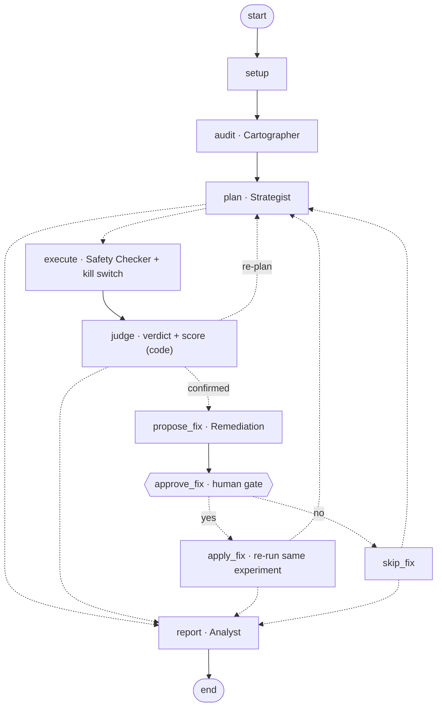
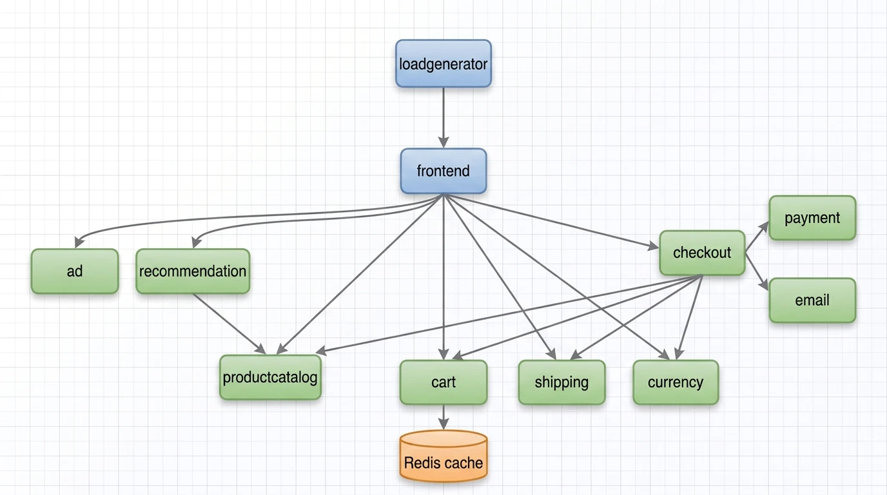

# FantasticFour: AI-Driven Chaos Engineering for Cloud-Native Resilience

> **Bosch Hackathon 2026.** An AI that **audits** a microservices system for weak spots, **plans** experiments with predictions, **breaks things safely** behind a deterministic kill switch, catches **silent failures** that monitoring misses, **scores** resilience and **proves fixes** by re-running the same experiment.

**Findings report:** [FINDINGS.md](FINDINGS.md) · **Architecture (1 page):** [docs/ARCHITECTURE.md](docs/ARCHITECTURE.md) · **Run it:** [docs/RUNNING.md](docs/RUNNING.md) · **Agents:** [docs/AGENTS.md](docs/AGENTS.md) · **Team form:** [docs/TEAM_FORM.md](docs/TEAM_FORM.md)

## Project status
**Feature-complete and frozen.** One entry point: `.venv/bin/python -m chaosmind.graph` ([quick start](#quick-start)). 82 automated tests, no cluster or API key needed (the [quick start](#quick-start) command runs 65; the portable prototype's other 17 also need `.venv/bin/pip install -r requirements-portable.txt`). **Mission control** web UI: `python3 -m chaosmind.ui`.

- **Proven live:** the kill switch (all three triggers, crash fail-safe, manual abort), and **three full AI runs end to end** ([run 1](runs/agents-20261010T185909Z), [run 2](runs/agents-20261010T192511Z), [run 3](runs/agents-20261010T200021Z)). The AI chose 9 experiments, ranked by blast radius × criticality. Code judged them against criteria written before each run, with thresholds above baseline noise: **8 confirmed, 1 refuted** (a checkout pod kill caused no measurable harm). In the Redis kill with the fix already in place, only the latency criterion held; the data-loss criterion failed, meaning the fix worked. The AI proposed **4 fixes; a human approved each on screen; each was applied and the same experiment re-run. All 4 scored higher, and 2 hypotheses were refuted after their fix.** The Analyst wrote a report for each run; code marks the claims in it that the measurements or the config contradict.
- **Fault types proven live:** pod failure, pod kill, network delay. **Defined and validated, not yet run live:** packet loss, network partition, CPU stress, full disk.
- **Model:** open-weight `gpt-oss-20b`, hosted by NVIDIA. A dry run (audit + plan + safety review) takes 25–45 s; a live experiment takes 4–6 minutes.
- **Not done yet:** the clean install from scratch on a second laptop.

## Highlights
| | |
|---|---|
| 🔍 **Found a silent data-loss bug, then fixed it** | Restarting Redis emptied shoppers' carts, and **nothing reported it**: pages kept answering HTTP 200 with the cart empty (the cart test saw zero failed requests). Error-rate monitoring alone would never notice. Our integrity checks caught it, and our fix made the cart survive the same experiment (**1 → 0 before, 1 → 1 after**; resilience score **40 → 81**). The AI loop later found, confirmed and fixed it on its own, with human approval. The fix stops the data loss; with one Redis replica, carts are still slow during a restart. |
| 🛑 **Kill switch: detects in ~8–10 s, reverts in ~0.3 s** | Every experiment runs under a guard that polls every 2 s and reverts automatically on error rate, latency or service-health breaches. Proven live on all three triggers, plus a crash fail-safe (`kill -9` on the guard) and manual abort. |
| 🧠 **AI that can't talk its way into the cluster** | Agents only return JSON. Every configuration fact the AI cites is checked against the live config, and mismatches are dropped; its interpretations stay hypotheses until an experiment tests them. Code computes every verdict against criteria written *before* each run, and raises any threshold that normal noise could meet. Code also flags report claims the measurements contradict. No agent can enlarge an experiment or loosen a safety limit. |
| 🤖 **The AI fixes what it finds, with a human in the loop** | 4 fixes proposed by the AI, approved on screen, applied, and proven by re-running the identical experiment: **frontend 18 → 96**, **cart service 31 → 78**, **catalog 70 → 99**, **Redis 13 → 50**. Fixes it can't prove are rolled back, and fixes already in place are never offered again. |
| 📈 **Measured, not guessed** | Catalog pod kill, 5 trials each: **1 replica → customers hurt 5 of 5 times** (errors for 32–38 s although the pod was back in ~3 s); **2 replicas → 0 of 5** (never hurt). The 95% intervals (57–100% vs 0–43%) don't overlap. |
| 🔁 **Reproducible results** | A catalog-latency experiment repeated twice: guard tripped at **9.6 s** both times, recovery **14.1 s / 14.0 s**. |
| 📊 **Live dashboard** | Grafana shows shoppers, throughput, errors, p95, confirmed faults, pod health, CPU and memory while experiments run. |

## How it works
The agents run as a **[LangGraph](https://github.com/langchain-ai/langgraph) state machine**. The diagram below mirrors the graph exported from the code (raw export: [docs/WORKFLOW.md](docs/WORKFLOW.md)). Dashed arrows are routing decisions made by code, not by the AI.




1. **Audit:** the **Cartographer** reads the live configuration (call graph, replicas, probes, storage) and ranks vulnerabilities. Every fact it cites is checked against the real config.
2. **Hypothesise:** the **Strategist** turns each vulnerability into an experiment, predicts the blast radius and writes measurable pass/fail criteria **before** the run.
3. **Inject safely:** the **Safety Checker** approves, shrinks or rejects (it can only make experiments smaller), then ramps intensity step by step through the kill switch.
4. **Judge:** integrity checks verify the cart survived and orders really complete; code decides **confirmed / refuted**, computes a **0–100 resilience score** (errors, latency, recovery, blast radius, integrity), and times capacity recovery and customer recovery separately.
5. **Measure likelihood:** repeated trials of the same experiment give a **failure frequency with a 95% confidence interval** ("customers hurt in X of N pod kills"), not a single anecdote.
6. **Fix and prove:** **Remediation** applies a reviewed fix and re-runs the identical experiment, keeping the fix only if the score improves.
7. **Report:** the **Analyst** explains each result from the error logs captured during that experiment and writes `FINDINGS.md`. Code fact-checks every number and flags any data-loss claim the integrity checks contradict.

| Component | Status |
|---|---|
| Cartographer · Strategist · Safety Checker | ✅ Validated in 14 dry runs, then a **live run** on NVIDIA-hosted `openai/gpt-oss-20b`: Redis kill planned, approved by the Safety Checker, cart loss confirmed by code |
| Integrity checks · resilience score · Remediation · Analyst | ✅ Built and tested; every published score is regenerated from raw evidence ([scoreboard](docs/evidence/SCOREBOARD.md)) |
| Orchestration: LangGraph state machine with a **human approval gate** before any fix and **checkpoint/resume** for long runs | ✅ Built and tested (incl. resume in a fresh process) |
| **Chosen by measurement:** two independent agent implementations, 12 real dry runs on frozen identical inputs, scored by one script | ✅ This one won ([bake-off](docs/team/log/BAKEOFF_RESULT.md)): 0 hallucinated facts, 100% valid experiments, 3 fault types per plan, integrity checks on every Redis test. *The bake-off chose the design and ran on `gpt-5.6-luna`, before the switch to `gpt-oss-20b`; the shipped model was validated separately in the three live runs.* |
| Injector + kill switch (`inject.py`, `guard.py`) | ✅ Proven live |
| Grafana dashboard | ✅ Running |
| Fault types: **proven live** | Pod failure · pod kill · network delay |
| Fault types: defined and validated, awaiting first live run | Packet loss · network partition · CPU stress · full disk |

## Target application and dependency map

[Google Online Boutique](https://github.com/GoogleCloudPlatform/microservices-demo) (Apache-2.0), release `v0.10.4`: an e-commerce demo with 10 business services in 5 languages, communicating over gRPC, plus Redis.

**The map is generated automatically** by [`chaosmind/agents/facts.py`](chaosmind/agents/facts.py) from the deployed manifests: every `*_ADDR` environment variable is a service-to-service call. It found **15 calls** (plus load generator → frontend), and **they match Google's architecture diagram**:

| Caller (generated) | Calls |
| :--- | :--- |
| frontend | adservice, cartservice, checkoutservice, currencyservice, productcatalogservice, recommendationservice, shippingservice |
| checkoutservice | cartservice, currencyservice, emailservice, paymentservice, productcatalogservice, shippingservice |
| recommendationservice | productcatalogservice |
| cartservice | redis-cart |



*Manual correction:* the frontend also declares an optional `SHOPPING_ASSISTANT_SERVICE_ADDR`. That service isn't deployed in our release, so the generator drops the edge.

**What the map predicts:**
- `productcatalog` has the most callers, so it has the widest blast radius.
- `checkout` depends on 6 services, so it's the most fragile path.
- `redis-cart` is a single store behind `cart`, so it's a data-loss risk.
- `ad` and `recommendation` are optional, so they should degrade gracefully.

## Safety controls
- **Validation:** 7 fault types, real targets only, namespace `online-boutique` only, duration ≤ 120 s, intensity caps.
- **Pre-flight:** refuses to inject into an unhealthy app or while another fault is active.
- **Kill switch:** polls every 2 s; reverts on **error rate > 5%**, **p95 > 1,000 ms** or **> 2 unhealthy services**. A breach is detected ~8–10 s after injection (the guard reads the load generator's rolling ~10 s window), and the fault is removed ~0.3–0.4 s later. Moderate error spikes must persist two polls, so background noise doesn't cause false trips.
- **Fail-safe:** every fault carries Chaos Mesh's own `duration`, so it ends even if the guard is killed (`kill -9` tested).
- **Always revert** on errors and Ctrl-C; **scoped abort**; runtime limits can only be **tightened**; AI agents never touch the cluster.
- **Code overrules the model** (none of these depend on the prompt):
  - experiments on the checkout/revenue path are capped at 500 ms delay and shrunk to 30 s when longer than 60 s
  - a baseline marked unsuitable means every experiment is rejected and live runs refuse to start
  - a "data loss" claim or prediction against a service with a persistent volume is rejected as contradicting the facts
  - every proposal code drops goes back to the model **once** with the reason, and the corrected ones are added: a wrong prediction costs a retry, not the experiment. A plan with only one fault type is sent back the same way

## Results
**Steady-state baselines** (no faults):

| Study | Shoppers | Samples | Req/s | Errors | p95 latency | Checkout success | Unhealthy / restarts |
|---|---|---|---|---|---|---|---|
| [15 min, before monitoring](docs/evidence/BASELINE_STUDY.md) | 20 | 181 | 4.37 | 0.05% (2 / 3,933) | 78 ms mean | 98.8% (166/168) | 0 / 0 |
| [5 min, with monitoring](runs/baseline-study-20261010T093022.185681Z/BASELINE_RESULTS.md) | 20 | 62 | 4.55 | 0.07% (1 / 1,372) | 35 ms mean | 98.6% (68/69) | 0 / 0 |
| [5 min, final](runs/baseline-study-20261010T181454.739973Z/BASELINE_RESULTS.md) → [`baseline.json`](baseline.json), used by the agents | 20 | 61 | 4.36 | **0% (0 / 1,308)** | 27 ms mean | **100% (55/55)** | 0 / 0 |
| 90 s steady phase of the [stress runs](runs/grafana-stress-20261010T083902Z/high-load.txt) | **100** | 2 runs | 22.3–22.4 | 0.05% (1 / ~2,015 each) | ~210 ms (cumulative) | — | — |

The lower p95 in the second 20-shopper study follows the monitoring install, which redeployed the load generator; all are far below the 1,000 ms limit, and the agents use the final one. Each experiment is compared with the baseline at the **same load**.

**At 20 shoppers**

| Experiment | What happened | Kill switch | Recovery |
|---|---|---|---|
| 500 ms delay on `productcatalogservice` | p95 rose to 3,500 ms (peak 4,100 ms); no errors | Tripped on **p95** at 7.8 s, fault removed 0.33 s later | 14.8 s |
| `cartservice` unavailable | Error rate 35%, p95 2,700 ms | Tripped on **error rate** at 8.1 s, removed 0.38 s later | 55.5 s |
| `adservice` unavailable | **0% errors**: frontend degrades gracefully | Tripped on **service health** at 9.2 s, removed 0.38 s later | 36.1 s |
| Guard killed with `kill -9` mid-fault | Fault still ended on Chaos Mesh's own timer | Fail-safe ✅ | — |
| Manual abort, 2 active faults | Both removed in 0.39 s | ✅ | — |
| `redis-cart` restarted, **before the fix** | **Cart emptied (1 → 0)**, zero failed requests | — | 4.9 s |
| `redis-cart` restarted, **after the fix** | **Cart kept (1 → 1)**, zero errors | — | 3.3 s |

**At 100 shoppers (stress), against the 100-shopper reference above**

| Experiment | What happened | Kill switch | Recovery |
|---|---|---|---|
| 500 ms delay on catalog, run twice | p95 **4,300 / 4,400 ms** (reference ~210 ms) | Tripped on **p95** at 9.6 s both times, removed 0.30–0.32 s later | **14.1 / 14.0 s** |
| `productcatalogservice` pod killed | Replacement pod up in ~3 s, but **66 HTTP 500s** and checkout 16/179 failed | Pre-flight + recovery checks (a kill can't be reverted) | Customers back after **~34 s** |

**Repeated trials: catalog pod kill, 1 vs 2 replicas** (20 shoppers, 5 trials each, customer limits fixed before testing: errors > 5% or p95 > 1,000 ms)

| Catalog replicas | Customers hurt | 95% interval | Pod back | Customers recovered |
|---|---|---|---|---|
| 1 | **5 of 5** | 57–100% | ~3 s | after **32–38 s** (errors up to 96%, p95 up to 20 s) |
| 2 | **0 of 5** | 0–43% | ~3 s | **never hurt** (errors ≤ 2.4%) |

**Resilience scores, ranked:** the [scoreboard](docs/evidence/SCOREBOARD.md) recomputes every score from the raw evidence and ranks the experiments worst first. Six fixes proven by re-running the identical experiment, four of them inside the live AI loop: **frontend 18 → 96**, **cart service 31 → 78**, **catalog 70 → 99** (AI loop) and **29 → 100** (5 trials each), **Redis 40 → 81** (cart test) and **13 → 50** (AI loop). Redis stays lowest: the fix stopped the data loss, but customer disruption during a restart didn't improve (one replica).

Raw guard events per trial: [1 replica](runs/trials-catalog-podkill-20261010T182606Z/trials.json), [2 replicas](runs/trials-catalog-podkill-20261010T183121Z/trials.json); `python3 -m chaosmind.agents.trials summary` recomputes this table from them. In two of the 1-replica trials traffic stalled completely, so the kill switch reverted early; those count as breaches because the errors that followed were measured.

### Findings (most severe first)
1. 🔴 **Silent cart data loss: fixed and verified ✅.** Redis kept every cart on a temporary `emptyDir` volume that's deleted with the pod, so a restart wiped all carts while the site kept answering HTTP 200. **Fix** (`bash scripts/redis-fix.sh apply`): a PersistentVolumeClaim for `/data`, Redis append-only logging, and the `Recreate` rollout strategy. **Re-test:** the cart survives the same experiment ([before/after](docs/evidence/REDIS_FIX_RESULTS.md)), and the AI loop reproduced the whole cycle live: found → confirmed → fix approved by a human → cart kept. **What the fix doesn't change:** with one Redis replica, a restart still causes errors and 2–6 s cart requests.
2. 🔴 **The frontend is a single point of failure (found by the AI).** The AI ranked it first (blast radius: every service) and confirmed it: frontend down → 100% errors. *Fix, applied by the AI loop after approval:* 2 replicas → **0% errors on the same experiment; score 18 → 96; hypothesis refuted after the fix**.
3. 🔴 **The currency service is a single point of failure (found by the AI).** Down → 100% errors, because every page shows prices. *Fix:* 2 replicas (not in the reviewed catalog yet, so the AI applied nothing).
4. 🟠 **A cart outage takes the shop down.** Losing `cartservice` drives errors to 35–100% and takes ~55 s to recover. *Fix, applied by the AI loop after approval:* 2 replicas → errors 100% → 0%, score 31 → 78. p95 still reached 2.7 s, so the latency part of the hypothesis stays confirmed.
5. 🟠 **"Healthy" ≠ recovered.** After a catalog pod kill, Kubernetes reported the service healthy in ~3 s, yet customers saw errors and 10–20 s responses for ~30 s more, in **5 of 5** repeated trials. Health checks alone would have hidden it. *Fix, measured:* **2 replicas → customers hurt in 0 of 5** trials; frontend retries with backoff would help further.
6. 🟠 **A payment outage hides inside the overall error rate (found by the AI).** Killing payment kept the overall error rate at or below 4.5%, under our own kill switch's 5% limit, while 2 of 5 checkouts failed. *Fix:* 2 replicas, plus a checkout-specific error limit in our kill switch and score.
7. 🟡 **Catalog latency spreads everywhere.** 500 ms on one service pushes the whole site's p95 to 3.5–4.4 s, as the map predicted for the service with the most callers. *Fix:* client-side timeouts and caching of catalog reads.
8. 🟡 **Checkout fails ~1.3% of the time with nothing broken (likely cause found).** 3 HTTP 500s in 237 checkouts across both baselines, always on `POST /cart/checkout`. We've ruled out the load generator's card data (expiry and card numbers are always valid). **Lead:** in a baseline taken under host memory pressure, `paymentservice` failed its liveness probe and restarted while **4 of 56** checkouts failed; the final baseline, with memory headroom, had **0 of 55**. Resource pressure on payment is the likely cause, not application logic.
9. 🟢 **Ads fail gracefully**, exactly as the map predicted.

Full evidence: [`docs/evidence/`](docs/evidence) and the `runs/` directory (CSV + JSONL for every run).

## Quick start
Full guide: [docs/RUNNING.md](docs/RUNNING.md). **Requires Linux with rootless Podman and systemd** (tested on Fedora); Docker Desktop and macOS aren't supported by the setup scripts yet.
```bash
bash scripts/deploy-local.sh && bash scripts/install-chaos.sh && bash scripts/load.sh start 20 2
```
Run one experiment under the kill switch:
```bash
python3 -m chaosmind.guard experiments/test-delay.json
```
One-time: install LangGraph into a local virtual environment:
```bash
python3 -m venv .venv && .venv/bin/pip install -r requirements.txt
```
Let the AI audit, plan and review (copy `.env.example` to `.env` and add your `NVIDIA_API_KEY`; check it with `python3 -m chaosmind.agents.llm --ping`):
```bash
.venv/bin/python -m chaosmind.graph --dry-run
```
Repeat one experiment to measure how often customers are hurt (with a 95% interval):
```bash
python3 -m chaosmind.agents.trials run experiments/catalog-podkill.json --repeat 5
```
Open **mission control**, the web UI: architecture map, the AI's weak spots and ranked experiments, live customer-impact charts with the kill-switch limits, verdicts, scores, and fix approval in the browser. Then open http://127.0.0.1:8090:
```bash
python3 -m chaosmind.ui
```
Run the full AI workflow, approving fixes in the UI (without `--ui`, approve in the terminal; `--resume runs/agents-…` continues an interrupted run):
```bash
.venv/bin/python -m chaosmind.graph --budget 3 --remediate --ui
```
Tests (no cluster or API key needed):
```bash
python3 -m chaosmind.test_guard && python3 -m unittest chaosmind.agents.test_agents chaosmind.agents.test_day2 chaosmind.test_c_tests && .venv/bin/python -m unittest chaosmind.test_graph chaosmind.test_ui
```

## Repository layout
**The product is `chaosmind.graph`.** Everything else is labelled:
- `python3 -m chaosmind.agents`: a dependency-free fallback that runs the *same* steps without LangGraph (no approval gate UI, no resume). The tests use it.
- `chaosmind/portable/`, `profiles/`, `deploy/portable/`: a prototype of the workflow for other apps behind an HTTP API. **Not used for any result here.**
- `docs/adk/`: a design we evaluated and didn't build. `docs/team/log/`: the build log (run reports, checklists, how this implementation was chosen). Not needed to run the project.

```
chaosmind/            graph.py (LangGraph workflow) · ui.py + ui.html (mission control) · inject.py · guard.py (kill switch) · monitor.py · baseline.py
chaosmind/agents/     cartographer · strategist · safety · remediation · analyst · integrity · score · scoreboard · trials · steps (shared by graph + fallback loop)
experiments/          one experiment per failure type in the brief
remediation/          reviewed fix catalog (Redis persistence, replicas) + scripts/redis-fix.sh
scripts/ deploy/ chaos/ monitoring/   cluster, Chaos Mesh, load generation, Prometheus/Grafana
runs/                 evidence from every run
docs/                 architecture, running guide, agents, evidence reports
chaosmind/portable/   prototype: the same workflow for any app via profiles + an HTTP API (offline demos; not used for live runs)
```

## Team, tools and models
| Member | Contribution |
|---|---|
| Aashrith | Platform: kind/Podman cluster, Chaos Mesh, Prometheus/Grafana, baselines, live verification runs |
| Srinavith | Fault injection and kill-switch design; AI agents; integrity checks and resilience score |
| Harshil | Customer simulator, integrity-check validation, demo video |
| Smrithi | Prompt tuning, architecture overview, reproducible setup |

**Software:** Online Boutique v0.10.4 (Apache-2.0), kind, Podman, Kubernetes, Chaos Mesh 2.8.4, Helm 3.19, Locust, kube-prometheus-stack 92.3.0, LangGraph 1.2 (orchestration), Python standard library (agents), `requests` + `prometheus_client` (simulator).
**AI model:** `openai/gpt-oss-20b`, open weights, hosted by NVIDIA (21B total parameters, mixture-of-experts with 3.6B active per token), via NVIDIA's OpenAI-compatible API with `NVIDIA_API_KEY`. Swap with `NIM_MODEL`; it was the smallest model that completed the whole agent workflow on our account ([model check](docs/team/log/MODEL_CHECK_FINDINGS.md)).
**Data:** synthetic only: simulated shoppers and the app's built-in demo products.
