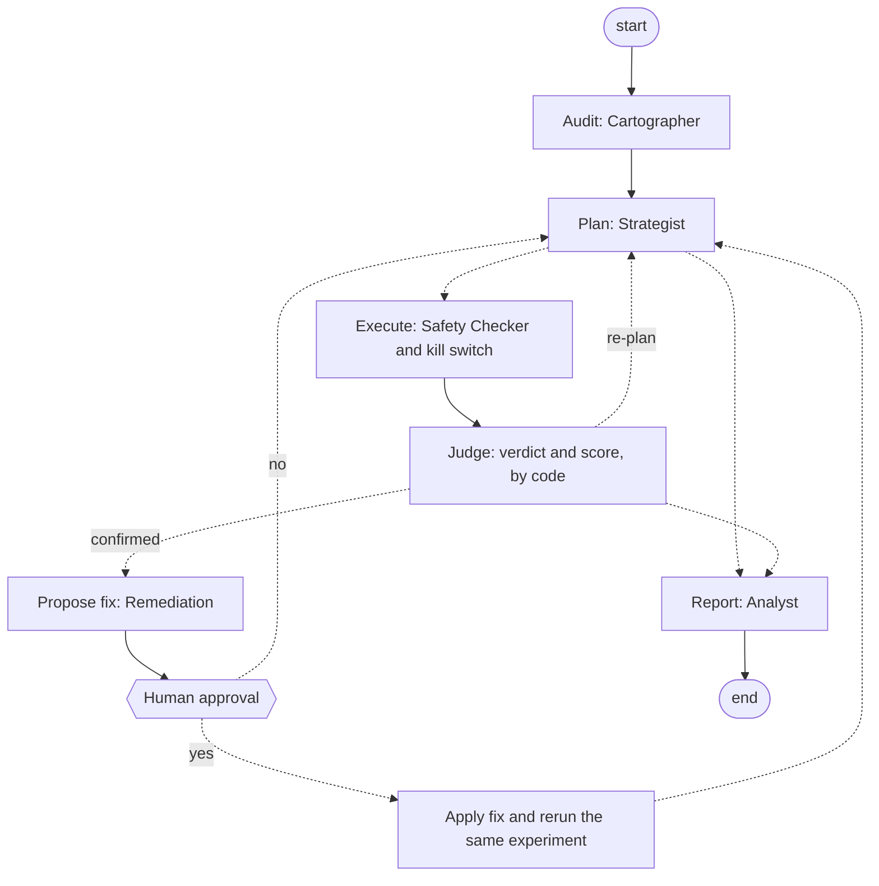

# ChaosMind: AI-driven chaos engineering for cloud-native resilience

**Team FantasticFour** | Bosch Hackathon 2026

ChaosMind is an AI system that audits a Kubernetes microservices application for weak spots, plans experiments to test them, injects failures safely behind a deterministic kill switch, measures what customers actually experience, scores resilience, and proves its own fixes by running the same experiment again. We tested it on Google's Online Boutique.

| Deliverable | Where |
|---|---|
| Demo video (3 minutes) | **VIDEO LINK HERE** |
| Findings report | [FINDINGS.md](FINDINGS.md) |
| Architecture overview | [docs/ARCHITECTURE.md](docs/ARCHITECTURE.md) |
| Team form | [docs/TEAM_FORM.md](docs/TEAM_FORM.md) |
| Source code | This repository. Entry point: `python -m chaosmind.graph` |

## Results at a glance

- **The AI found real weaknesses on its own.** In 8 live runs it chose 27 experiments across 5 fault types. Code judged each one against criteria the AI wrote before the experiment: 24 confirmed, 3 refuted.
- **It fixes what it finds, with a person in the loop.** The AI proposed 11 fixes from a reviewed catalog. A person approved each one on screen, it was applied, and the identical experiment ran again. All 11 scored higher, by 56 points on average, and 6 hypotheses no longer held after the fix.
- **It catches failures monitoring cannot see.** Restarting Redis empties every shopper's cart while every page still answers HTTP 200. Our integrity checks caught it; error-rate dashboards never would. The fix was proven by repeating the experiment: the cart was kept every time.
- **Measured, not guessed.** Killing the catalog pod hurt customers in 5 of 5 trials with one replica and in 0 of 5 with two (95% intervals 57% to 100% and 0% to 43%, no overlap).
- **It is safe to run.** A kill switch polls every 2 seconds and removes a fault 0.3 seconds after a breach. It was proven live on all three triggers, on `kill -9` of the kill switch itself, and on manual abort. When an overloaded laptop made the shop look unhealthy, the Safety Checker and the kill switch both refused to inject.
- **11 ranked findings**, each with evidence, a resilience score and a fix: see the [findings report](FINDINGS.md). Every score is recomputed from raw evidence by one command ([scoreboard](docs/evidence/SCOREBOARD.md)).

## How it works

The agents run as a LangGraph state machine. Dashed arrows are routing decisions made by code, not by the AI. The full design is in the [architecture overview](docs/ARCHITECTURE.md).



1. **Audit.** The Cartographer reads the live configuration (who calls whom, replicas, probes, storage) and names weak spots. Code checks every fact it cites.
2. **Plan.** The Strategist turns each weak spot into an experiment with a prediction and pass/fail criteria, written before anything breaks. Code ranks the experiments by blast radius times criticality.
3. **Execute.** The Safety Checker approves, shrinks or rejects the experiment, then ramps intensity step by step through the kill switch.
4. **Judge.** Code decides confirmed or refuted and computes a 0 to 100 resilience score. Integrity checks confirm that carts survive and orders still complete.
5. **Fix.** Remediation proposes a reviewed fix. After a person approves it, the identical experiment runs again and the fix is kept only if the score improves.
6. **Report.** The Analyst explains the results from the captured logs. Code fact-checks every number and marks claims the data contradicts.

## Mission control

A local web UI shows the whole loop while it runs: the dependency map with the selected experiment's blast radius, the weak spots, the ranked experiments, live error and latency charts with the kill-switch limits, verdicts, scores, and an **Approve fix** button for the human gate. Start it with `python3 -m chaosmind.ui` and open http://127.0.0.1:8090.

## Target application

[Google Online Boutique](https://github.com/GoogleCloudPlatform/microservices-demo) v0.10.4 (Apache-2.0): an online shop with 10 services in 5 languages, talking over gRPC, plus Redis for carts.

ChaosMind builds the dependency map itself from the deployed manifests, using each `*_ADDR` environment variable as a service-to-service call. It found 15 calls, matching Google's architecture diagram:

| Service | Calls |
|---|---|
| frontend | adservice, cartservice, checkoutservice, currencyservice, productcatalogservice, recommendationservice, shippingservice |
| checkoutservice | cartservice, currencyservice, emailservice, paymentservice, productcatalogservice, shippingservice |
| recommendationservice | productcatalogservice |
| cartservice | redis-cart |


The map predicted where to look, and the experiments confirmed it: the catalog has the most callers and the widest blast radius, checkout depends on 6 services, Redis is a single store behind the cart, and ads and recommendations are optional.

## Safety controls

- **Validation:** only 7 known fault types, only real deployments, only the `online-boutique` namespace, at most 120 seconds, capped intensity.
- **The AI cannot touch the cluster.** Agents return JSON; code validates it and acts. The Safety Checker can only make experiments smaller.
- **Pre-flight:** no injection into an unhealthy application or while another fault is active.
- **Kill switch:** reverts when errors exceed 5%, p95 latency exceeds 1,000 ms or more than 2 services are unhealthy. A breach is detected 6 to 10 seconds after injection (the load generator reports a rolling window) and the fault is gone about 0.3 seconds later.
- **Fail-safe:** every fault carries Chaos Mesh's own timer, so it ends even if the kill switch dies (tested with `kill -9`).
- **Human approval** before any fix, and fixes only from a reviewed catalog.

## Quick start

Full guide: [docs/RUNNING.md](docs/RUNNING.md). Run every command from the repository root, in order.

**Requirements:** Linux with rootless Podman and systemd (tested on Fedora; Docker Desktop and macOS are not supported by the setup scripts yet), [kind](https://kind.sigs.k8s.io/docs/user/quick-start/#installation), Python 3.10 or newer, `git`, `curl`, `rg` (ripgrep), about 4 free CPU cores and 8 GB of free RAM, and an `NVIDIA_API_KEY` (free at build.nvidia.com). `scripts/install-kubectl.sh` installs a checksum-verified `kubectl` (x86-64, uses `sudo`); Helm is downloaded automatically.

**1. Cluster, application, chaos engine and shoppers** (the first run downloads images; allow 10 to 15 minutes):
```bash
bash scripts/install-kubectl.sh   # skip if you already have kubectl
bash scripts/deploy-local.sh && bash scripts/install-chaos.sh && bash scripts/load.sh start 20 2
```
**2. Kernel modules for network faults** (delay, packet loss, partition; needed again after a reboot):
```bash
sudo modprobe -a ip_tables iptable_filter iptable_mangle ip_set ip_set_hash_ip xt_set sch_netem
```
**3. Python environment and model key:**
```bash
python3 -m venv .venv && .venv/bin/pip install -r requirements.txt
cp .env.example .env   # then put your NVIDIA_API_KEY in .env
python3 -m chaosmind.agents.llm --ping
```
**4. Measure normal behaviour on your machine** (about 6 minutes). Every verdict, threshold and score is relative to this baseline, so take it on the machine that runs the experiments. It must end with `baseline suitable: True`; if not, free some memory and repeat:
```bash
bash scripts/baseline.sh --duration 300
```
**5. Check the safety net** with one experiment under the kill switch. It must trip on latency and revert within a second:
```bash
python3 -m chaosmind.guard experiments/test-delay.json
```
**6. Let the AI audit, plan and review** (injects nothing; 25 to 45 seconds):
```bash
.venv/bin/python -m chaosmind.graph --dry-run
```
**7. Run the full AI workflow live.** Start mission control in one terminal and open http://127.0.0.1:8090:
```bash
python3 -m chaosmind.ui
```
Then, in a second terminal (15 to 20 minutes; click **Approve fix** in the browser when it asks; without `--ui`, approve in the terminal; `--resume runs/agents-<time>` continues an interrupted run):
```bash
.venv/bin/python -m chaosmind.graph --budget 6 --remediate --ui
```
**Before a recorded run:** approved fixes stay applied, so after a practice run put the original weaknesses back and take a fresh baseline (step 4). Pause software updates and stop Docker first: background CPU load raises latency, and the kill switch then refuses to inject into an application that already looks unhealthy.
```bash
bash scripts/reset-weaknesses.sh
```
**Repeat one experiment** to measure how often customers are hurt, with a 95% interval:
```bash
python3 -m chaosmind.agents.trials run experiments/catalog-podkill.json --repeat 5
```
**Tests** (no cluster or API key needed; 74 tests, plus 17 for the prototype in `chaosmind/portable` after `.venv/bin/pip install -r requirements-portable.txt`):
```bash
python3 -m chaosmind.test_guard && python3 -m unittest chaosmind.agents.test_agents chaosmind.agents.test_day2 chaosmind.test_c_tests && .venv/bin/python -m unittest chaosmind.test_graph chaosmind.test_ui
```

## Repository layout

```
chaosmind/graph.py        LangGraph workflow (the product's entry point)
chaosmind/ui.py, ui.html  mission control web UI
chaosmind/inject.py       fault validation and Chaos Mesh resources
chaosmind/guard.py        kill switch
chaosmind/agents/         cartographer, strategist, safety, remediation, analyst,
                          integrity checks, score, scoreboard, trials
experiments/              ready-made experiments, one per fault type
remediation/              reviewed fix catalog (Redis persistence, replicas)
scripts/, deploy/, chaos/, monitoring/
                          cluster setup, Chaos Mesh, load generation, Prometheus and Grafana
runs/                     raw evidence from every run (CSV and JSON)
docs/                     architecture, running guide, agents, evidence reports
```

Also in the repository, and not part of the product: `python3 -m chaosmind.agents` runs the same steps without LangGraph (the tests use it); `chaosmind/portable/` is a prototype for other applications behind an HTTP API; `docs/adk/` is a design we evaluated and did not build; `docs/team/` holds the team's working notes and build log.

## Team

| Member | Contribution |
|---|---|
| Aashrith | Platform: kind and Podman cluster, Chaos Mesh, Prometheus and Grafana, baselines, live verification runs |
| Srinavith | Fault injection and kill switch, AI agents, integrity checks, resilience score, mission control |
| Harshil | Customer simulator, integrity-check validation, demo video |
| Smrithi | Prompt tuning, architecture overview, reproducible setup |

## Tools, model and data

- **AI model:** `openai/gpt-oss-20b`, open weights, hosted by NVIDIA (21B parameters in total, 3.6B active per token), through NVIDIA's OpenAI-compatible API. It was the smallest model that completed the full agent workflow on our account; any other hosted model can be set with `NIM_MODEL`.
- **Software:** Online Boutique v0.10.4, kind, rootless Podman, Kubernetes, Chaos Mesh 2.8.4, Helm 3.19, Locust, kube-prometheus-stack 92.3.0 (Prometheus and Grafana), LangGraph 1.2. The agents, kill switch and injector otherwise use only the Python standard library.
- **Data:** synthetic only: simulated shoppers and the application's built-in demo products.
