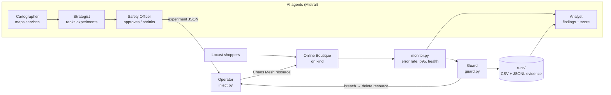

# FantasticFour: AI-Driven Chaos Engineering for Cloud-Native Resilience

> Bosch Hackathon 2026. An AI system that decides **what to break** in a microservices app, breaks it **safely**, watches how the system responds, and reports **ranked weaknesses, fixes and a resilience score**.

---

## Contents
- [The problem](#the-problem)
- [How it works](#how-it-works)
- [Target application and dependency map](#target-application-and-dependency-map)
- [Safety controls](#safety-controls)
- [Setup](#setup)
- [Running experiments](#running-experiments)
- [Results so far](#results-so-far)
- [Repository layout](#repository-layout)
- [Team, tools and models](#team-tools-and-models)

---

## The problem

Modern apps are dozens of small services calling each other. When one fails, nobody knows in advance what else breaks, how users are affected, or how long recovery takes. Teams usually find out during a real outage.

**Chaos engineering** finds out first, by deliberately injecting controlled failures (a crashed service, a slow network, an overloaded CPU) and observing the result. Doing this by hand is slow and unfocused. Our system automates the whole loop: **choose → inject safely → observe → analyse → recommend fixes**.

---

## How it works



| Component | Role | Status |
|---|---|---|
| **Online Boutique** on kind | The system under test (11 microservices + Redis) | ✅ Running |
| **Chaos Mesh** | Executes faults declared as Kubernetes resources; deleting the resource reverts the fault | ✅ Installed, injection verified |
| **Locust load generator** | 20 simulated shoppers browsing, adding to cart and checking out | ✅ Running |
| `chaosmind/inject.py` (**Operator**) | Validates experiments, creates/reverts Chaos Mesh resources, confirms injection | ✅ |
| `chaosmind/monitor.py` | Real error rate, p95 latency, checkout success, unhealthy services, restarts | ✅ |
| `chaosmind/guard.py` (**kill switch**) | Preflight → inject → watch every 2 s → auto-revert on breach → confirm recovery | ✅ Verified live |
| **Cartographer** agent (`chaosmind/agents/cartographer.py`) | Audits the live architecture and ranks its most vulnerable points; every cited fact is checked against the real config | ✅ Built, offline-tested |
| **Strategist** agent (`chaosmind/agents/strategist.py`) | Turns each vulnerability into an experiment with a prediction and pass/fail criteria; re-plans after each result | ✅ Built, offline-tested |
| **Safety Checker** agent (`chaosmind/agents/safety.py`) | Approves/shrinks/rejects, then injects through the guard with a gradual intensity ramp to find the breaking point | ✅ Built, offline-tested |
| Observer, Log Detective, Remediation, Documentor agents | Impact pre/post, root cause from logs, fix + re-run, findings report | 🚧 In progress ([AGENTS.md](AGENTS.md)) |
| **Grafana dashboard** (Prometheus + kube-state-metrics + Locust/Chaos exporters) | Live shoppers, throughput, errors, p95, confirmed faults, pod availability, CPU/memory, restarts | ✅ Running ([monitoring/README.md](monitoring/README.md)) |

**Design rule:** the kill switch is **deterministic code, not an LLM**. AI agents may propose experiments and make them *safer*, but they can never loosen or bypass the guard.

---

## Target application and dependency map

[Google Online Boutique](https://github.com/GoogleCloudPlatform/microservices-demo) (Apache-2.0), release `v0.10.4`: an e-commerce demo with 10 business services in 5 languages, communicating over gRPC, plus Redis.


Based on Google's architecture diagram and **checked against the deployment manifest**. Every `*_ADDR` environment variable is a service-to-service call, and all 17 edges match:

| Caller | Calls |
| :--- | :--- |
| loadgenerator | frontend |
| frontend | ad, recommendation, productcatalog, cart, shipping, currency, checkout |
| checkout | productcatalog, cart, shipping, currency, payment, email |
| recommendation | productcatalog |
| cart | redis-cart |

*Manual correction:* upstream `main` also gives `frontend` an optional `SHOPPING_ASSISTANT_SERVICE_ADDR`. It isn't in our deployed release, so it's excluded.

**What the map predicts:**
- `productcatalog` has the most callers, so it has the widest blast radius.
- `checkout` depends on 6 services, so it's the most fragile path.
- `redis-cart` is a single store behind `cart`, so it's a data-loss risk.
- `ad` and `recommendation` are optional, so they should degrade gracefully.

---

## Safety controls

Every experiment passes through layered safeguards. All of them have been **tested live** (evidence in [`KILLSWITCH_RESULTS.md`](KILLSWITCH_RESULTS.md)).

| Layer | What it does |
|---|---|
| **Validation** | Only known fault types; target must be a real deployment in namespace `online-boutique`; duration ≤ 120 s; latency ≤ 2000 ms |
| **Preflight** | Refuses to inject if the app is already unhealthy or another experiment is still active |
| **Confirmed injection** | Distinguishes "resource created" from "Chaos Mesh actually injected" |
| **Guard (kill switch)** | Polls every 2 s; reverts automatically when **error rate > 5%**, **p95 > 1000 ms** or **unhealthy services > 2** |
| **Recovery check** | After revert, waits until health and metrics are back within limits and records the recovery time |
| **Fail-safe duration** | Every fault carries Chaos Mesh's own `duration`, so it ends even if our guard process crashes (`kill -9` tested) |
| **Ctrl-C / errors** | Any interruption or error triggers revert in a `finally` block |
| **Scoped abort** | `python3 -m chaosmind.inject abort` removes all faults we own, and only those |
| **Tighten-only overrides** | Limits passed at runtime may only be made stricter |

---

## Setup

**Tested on:** Fedora Linux, rootless Podman, kind v0.33.0, Kubernetes v1.37, Chaos Mesh 2.8.4, Python 3.

### Prerequisites
- Linux with **rootless Podman** and systemd (the scripts run kind with the Podman provider)
- `kind`, `python3`, `curl`, `git`, `rg` (ripgrep)
- ~4 CPU cores and 8 GB RAM free (≈ 12 GB with Prometheus/Grafana)

### 1. Clone
```bash
git clone https://github.com/Gotha8972/FantasticFour.git
cd FantasticFour
```

### 2. Install kubectl (checksum-verified; skip if you already have it)
```bash
bash scripts/install-kubectl.sh
```

### 3. Create the cluster and deploy Online Boutique
```bash
bash scripts/deploy-local.sh
```
Creates the kind cluster `online-boutique`, deploys the app into namespace `online-boutique`, waits for every service, and checks `/` and `/cart`. The project kubeconfig is written to `.runtime/kubeconfig`.
The storefront is at **http://localhost:8080**.

### 4. Install Chaos Mesh
```bash
bash scripts/install-chaos.sh
```
Network faults need these kernel modules on the host:
```bash
sudo modprobe -a ip_tables iptable_filter iptable_mangle ip_set ip_set_hash_ip xt_set sch_netem
```

### 5. Start traffic
```bash
bash scripts/load.sh start 20 2
```
That's 20 simulated shoppers, starting at 2 per second. Check that traffic is flowing:
```bash
bash scripts/load.sh measure 5 30
```

### 6. Check everything without breaking anything
```bash
python3 -m chaosmind.test_guard
```
```bash
python3 -m chaosmind.verify --dry-run
```

---

## Running experiments

### Quick demo (≈5 min, watch it in Grafana)
```bash
bash scripts/grafana-stress.sh
```
20 shoppers → 100 shoppers → 500 ms delay on the product catalog through the guard → automatic revert → recovery, all visible on the **Online Boutique — Chaos Overview** dashboard.

### An experiment is a JSON file
```json
{"id": "test-delay", "fault": "network_delay", "target": "productcatalogservice",
 "params": {"latency": "500ms"}, "duration_s": 60,
 "hypothesis": "All pages slow down; nothing crashes"}
```
| Field | Allowed |
|---|---|
| `fault` | `pod_failure`, `pod_kill`, `network_delay`, `network_loss`, `network_partition`, `cpu_stress`, `disk_full` (see coverage table below) |
| `target` | Any deployment name, e.g. `cartservice`, `productcatalogservice` |
| `duration_s` | 1–120 |
| `params` | `network_delay`: `latency`, `jitter` (ms, ≤ 2000) · `network_loss`: `loss` (≤ 50%) · `network_partition`: `to` (the dependency to cut off) · `cpu_stress`: `load` (1–100), `workers` (1–2) · `disk_full`: `path` (a mounted volume, e.g. `/data`), `percent` (1–100) |

**Coverage of the failure types listed in the brief**

| Brief's example | How we inject it | Live status |
|---|---|---|
| Service or container crash | `pod_failure` (down for N s), `pod_kill` (instant kill + recreate) | ✅ pod_failure via guard; pod_kill via the Grafana demo script |
| Slow or lossy network | `network_delay`, `network_loss` | ✅ delay; loss defined, not yet run |
| Full disk | `disk_full`: Chaos Mesh IOChaos returns `ENOSPC` ("no space left on device") on the volume | Defined, not yet run |
| Overloaded database | `cpu_stress` on `redis-cart` | Defined, not yet run |
| Failed dependency | `network_partition`: e.g. `cartservice` can no longer reach `redis-cart` | Defined, not yet run |
| Sudden traffic spike | 20 → 100 shoppers (`scripts/grafana-stress.sh`) | ✅ run twice |

Ready-made experiments for each are in [`experiments/`](experiments/).

Samples are in [`experiments/`](experiments).

### Run one experiment under the kill switch
```bash
python3 -m chaosmind.guard experiments/test-delay.json
```
Optionally tighten the limits for this run:
```bash
python3 -m chaosmind.guard experiments/test-down.json '{"max_unhealthy": 0}'
```
The guard prints each event and writes evidence to `runs/<id>-<timestamp>/`:

| Event | Meaning |
|---|---|
| `CREATED` → `INJECTED` | Resource accepted, then injection confirmed by Chaos Mesh |
| `BREACH` | A limit was crossed (metric, value, limit recorded) |
| `ENDED` | Planned duration finished without a breach |
| `REVERTED` → `HEALTHY` | Fault removed, then the app confirmed back to normal (`recovery_s`) |
| `REFUSED` / `NOT_RECOVERED` / `ERROR` | Preflight blocked it, recovery timed out, or something failed |

### Run the verification suites
Runs both sample experiments end to end:
```bash
python3 -m chaosmind.verify
```
Health trigger, guard-crash fail-safe and manual abort:
```bash
./tests/killswitch.sh
```
Redis cart-persistence check:
```bash
./tests/redis_finding.sh
```

### Stop everything
Remove all chaosmind faults:
```bash
python3 -m chaosmind.inject abort
```
Stop traffic:
```bash
bash scripts/load.sh stop
```
Open the Chaos Mesh dashboard at http://localhost:2333:
```bash
bash scripts/chaos.sh dashboard
```

### Let the agents choose and run experiments
Needs `MISTRAL_API_KEY` in the environment or in `.env` (git-ignored).

Audit, plan and safety review only; nothing is injected:
```bash
python3 -m chaosmind.agents --dry-run
```
Live: up to 3 experiments, each ramped through the guard, re-planning after each result:
```bash
python3 -m chaosmind.agents --budget 3
```
Offline tests (no cluster, no API key):
```bash
python3 -m unittest chaosmind.agents.test_agents
```
Everything is saved to `runs/agents-<time>/`: facts, vulnerabilities, every plan and the full history with verdicts.

### Watch it live in Grafana
```bash
bash scripts/install-monitoring.sh
```
```bash
bash scripts/monitoring.sh grafana
```
Then open the **Online Boutique — Chaos Overview** dashboard at http://127.0.0.1:3000. Full guide: [monitoring/README.md](monitoring/README.md).

### Optional: standalone customer simulator
`customer_simulator.py` runs scripted shopper journeys with per-request error tracing and Prometheus metrics. See [`CUSTOMER_SIMULATION.md`](CUSTOMER_SIMULATION.md).

---

## Results so far

**Steady-state baselines** (20 shoppers, no faults):

| Study | Samples | Req/s | Errors | p50 / p95 (mean) | Checkout success | Unhealthy / restarts |
|---|---|---|---|---|---|---|
| [15 min, before monitoring](BASELINE_STUDY.md) | 181 | 4.37 | 0.05% (2 / 3,933) | 20 ms / 78 ms | 98.8% (166/168) | 0 / 0 |
| [5 min, with monitoring](runs/baseline-study-20261010T093022.185681Z/BASELINE_RESULTS.md) → [`baseline.json`](baseline.json), used by the agents | 62 | 4.55 | 0.07% (1 / 1,372) | 11 ms / 35 ms | 98.6% (68/69) | 0 / 0 |

Each experiment is compared with the baseline taken under the same conditions, not with zero.

**Kill-switch limits:** the runs below up to the catalog pod kill used the original limits (**20% errors / 2,000 ms p95**). The team then tightened them to **5% / 1,000 ms**, which the 100-shopper catalog-delay runs used and which are the current defaults.

| Experiment | What happened | Kill switch | Recovery |
|---|---|---|---|
| 500 ms delay on `productcatalogservice` | p95 rose to 3,500 ms (peak 4,100 ms); no errors | Breach on **p95** at 7.8 s, reverted in 0.33 s | 14.8 s |
| `cartservice` unavailable | Error rate 35% (peak 100% in one window), p95 2,700 ms | Breach on **error rate** at 8.1 s, reverted in 0.38 s | 55.5 s |
| `adservice` unavailable | **0% errors**, the frontend degrades gracefully | Breach on **unhealthy service** at 9.2 s, reverted in 0.38 s | 36.1 s |
| Guard killed with `kill -9` mid-fault | Fault still ended via Chaos Mesh's duration | Fail-safe ✅ | — |
| Manual abort with 2 active faults | Both removed in 0.39 s | ✅ | — |
| `productcatalogservice` pod killed (**100 shoppers**) | Replacement pod available in ~3 s, but **66 HTTP 500s**, checkout 16/179 failed (8.9%), peak error rate 25.6%, peak p95 10 s | One-shot kill (no revert possible); preflight + recovery checks | Customers back to normal after **~34 s** |
| 500 ms delay on `productcatalogservice` (**100 shoppers**), run twice | p95 **4,300 / 4,400 ms**, almost no errors | Breach on **p95** at 9.6 s both times (limit 1,000 ms), reverted in 0.30–0.32 s | **14.1 / 14.0 s**, reproducible |
| `redis-cart` pod restarted | **Cart emptied (1 item → 0) with zero HTTP errors**: silent data loss | — | 4.9 s |

**Findings so far** (most severe first)

1. 🔴 **Silent cart data loss.** `redis-cart` runs as 1 replica on an `emptyDir` volume, so any restart wipes every cart while the site reports success. Redis does save on shutdown, but into a folder that's deleted with the pod. *Fix (ready, before/after run pending):* `bash scripts/redis-fix.sh apply` moves `/data` to a PersistentVolumeClaim, turns on the append-only log (covers instant kills, not just clean shutdowns) and uses the `Recreate` strategy so two Redis pods never share the disk. `revert` restores the original for a live before/after demo. Trade-off: still 1 replica, so the cart is briefly unavailable during a restart, but no longer lost. Files: [`remediation/`](remediation/).
2. 🟠 **Cart outage takes the shop down hard.** Losing `cartservice` drives error rate to 35–100% and takes ~55 s to recover. *Fix:* more replicas plus a PodDisruptionBudget; degrade the cart page instead of failing.
3. 🟠 **"Healthy" ≠ recovered.** After a catalog pod kill, Kubernetes reported the service available in ~3 s, but customers kept getting errors and 10 s responses for ~30 s more. Health checks alone would have hidden it. *Fix:* more than 1 replica so a single kill isn't an outage; readiness that reflects real serving capacity; client retries with backoff in the frontend.
4. 🟡 **Catalog latency spreads everywhere.** 500 ms on one service pushes site-wide p95 to 3.5 s at 20 shoppers and 4.4 s at 100, reproducibly, consistent with it having the most callers. *Fix:* client-side timeouts and caching of catalog reads in the frontend.
5. 🟡 **Checkout fails ~1.3% of the time with nothing broken.** 3 HTTP 500s in 237 checkouts across both baselines, always `POST /cart/checkout`. Root cause not yet established (logs had rotated); next case for the Log Detective agent.
6. 🟢 **Ads fail gracefully**, as the map predicted.

*Load note:* the pod-kill and second catalog-delay runs used 100 shoppers; the baselines and other guarded runs used 20. Compare numbers within the same load level only.

Full evidence: [`KILLSWITCH_RESULTS.md`](KILLSWITCH_RESULTS.md), [`PROJECT_HANDOFF.md`](PROJECT_HANDOFF.md) and the `runs/` directory.

---

## Repository layout

```
chaosmind/
  inject.py          Operator: validate, create, confirm, revert, abort Chaos Mesh faults
  guard.py           Kill switch: preflight, watch, auto-revert, recovery check
  monitor.py         Metrics: Locust stats + Kubernetes health → snapshot()
  runlog.py          CSV/JSONL evidence writer
  capture.py         Standalone metric and pod-log capture
  verify.py          End-to-end verification of sample experiments
  baseline.py        Steady-state baseline study → baseline.json
  c_tests.py         Live kill-switch and Redis checkpoint runner
  podkill_demo.py, checkout_investigation.py   Pod-kill demo and checkout-failure log search
  test_guard.py      Offline behaviour tests (no cluster needed)
  agents/            Cartographer, Strategist, Safety Checker (+ facts.py, llm.py, loop in __main__.py)
experiments/         Experiment definitions (JSON), one per brief failure type
remediation/         Fixes for findings (Redis persistence patch + PVC)
chaos/               Chaos Mesh install values and standalone YAML experiments
deploy/              kind cluster and Online Boutique overlay
scripts/             Cluster, Chaos Mesh and load setup
tests/               Live kill-switch and Redis checks
runs/                Evidence from every run
monitoring/          Prometheus/Grafana setup and dashboard guide
docs/                Diagrams; docs/team/ holds our internal planning notes
customer_simulator.py  Optional scripted shopper with Prometheus metrics
```

---

## Team, tools and models

**Team FantasticFour**

| Member | Area |
|---|---|
| Aashrith | Platform: cluster, Chaos Mesh, monitoring (Prometheus/Grafana), baselines, verification |
| Harshil | Customer simulation and journey checks |
| Srinavith | Fault injection, kill switch, Safety Checker and Remediation agents |
| Smrithi | AI agents: orchestration, Cartographer, Strategist |

**Third-party software:** Online Boutique v0.10.4 (Apache-2.0), kind, Podman, Kubernetes, Chaos Mesh 2.8.4, Helm 3.19, Locust (bundled load generator), kube-prometheus-stack 92.3.0 (Prometheus, Grafana, kube-state-metrics), Python `requests` and `prometheus_client` (simulator only). The agents use only the Python standard library.

**AI models:** Mistral `mistral-small-latest` (Cartographer, Strategist, Safety Checker), as selected for the first dry run, via the Mistral chat API in JSON mode. `MISTRAL_LARGE` and `MISTRAL_SMALL` can override the client aliases.

**Data:** synthetic only. Simulated shoppers and the app's built-in demo products; no real user data.
