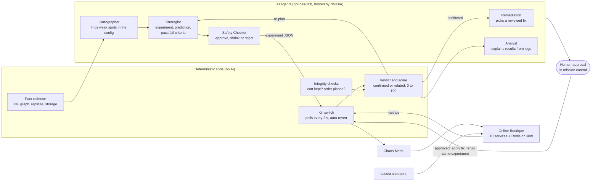

# Architecture overview

**ChaosMind** by Team FantasticFour | Bosch Hackathon 2026

ChaosMind finds weak spots in a Kubernetes application, tests them with controlled failures, and proves its fixes. One rule runs through the whole design: **the AI proposes, code verifies, and the kill switch always wins.** The AI never touches the cluster; it only returns JSON, and deterministic code checks it and acts on it.

## Components

| Layer | Component | What it does |
|---|---|---|
| AI agents | Cartographer | Reads the live configuration and names the weak spots, citing configuration facts as evidence |
| | Strategist | Turns each weak spot into an experiment with a predicted impact and pass/fail criteria written before the run |
| | Safety Checker | Approves, shrinks or rejects each experiment and plans a gradual intensity ramp |
| | Remediation | Chooses a fix from a catalog of reviewed changes; it cannot write its own patches |
| | Analyst | Explains each result from the error logs captured during that experiment and writes the run's report |
| Deterministic code | Fact collector | Builds the dependency map from the deployed manifests and computes blast radius and severity |
| | Injector and kill switch | Validates every experiment, creates the Chaos Mesh fault, polls every 2 s and reverts on a breach |
| | Integrity checks | Confirm that a test cart kept its item and a real order goes through, since HTTP 200 alone proves nothing |
| | Verdict, score, trials | Decide confirmed or refuted, compute a 0 to 100 resilience score, and repeat experiments for a 95% interval |
| Orchestration | LangGraph state machine | Runs audit, plan, execute, judge, fix and report; pauses for human approval; resumes after an interruption |
| Interface | Mission control | Local web UI: dependency map, the AI's plan, live customer-impact charts, verdicts, scores and the approval button |
| Platform | kind on rootless Podman | Online Boutique v0.10.4, Chaos Mesh 2.8.4, Locust load, Prometheus and Grafana |

## How the AI makes decisions
1. **Audit.** Code collects the facts (who calls whom, replicas, probes, storage). The Cartographer names the dangerous combinations, and code drops any claim whose cited fact does not match the real configuration.
2. **Rank.** Code ranks experiments by blast radius times criticality: how many services break with the target, times how severe the weakness is.
3. **Predict.** The Strategist writes the expected impact and measurable criteria before anything breaks. Code raises any threshold that normal noise could meet.
4. **Inject safely.** The Safety Checker can only make an experiment smaller. Every step runs through the kill switch.
5. **Judge.** Code compares the measurements with the criteria and decides confirmed or refuted. Integrity checks catch silent failures, such as an emptied cart behind an HTTP 200.
6. **Fix and prove.** For a confirmed weakness, Remediation picks a reviewed fix, a person approves it, and the identical experiment runs again. The fix is kept only if the score improves.
7. **Report.** The Analyst explains the results. Code fact-checks every number and marks claims that the measurements or the configuration contradict.

## Safety controls

| Control | Guarantee |
|---|---|
| Validation | Only 7 known fault types, only real deployments, only the `online-boutique` namespace, at most 120 s, capped intensity |
| No AI access to the cluster | Agents return JSON only; code validates it and acts |
| Only smaller | The Safety Checker cannot enlarge or retarget an experiment (enforced in code) |
| Hard limits on revenue paths | On the checkout path, delay is capped at 500 ms and runs longer than 60 s are cut to 30 s, whatever the model says |
| Pre-flight | No injection into an unhealthy application or while another fault is active |
| Kill switch | Reverts when errors exceed 5%, p95 exceeds 1,000 ms or more than 2 services are unhealthy |
| Fail-safe | Every fault carries Chaos Mesh's own timer, so it ends even if the kill switch crashes (tested with `kill -9`) |
| Human approval | No fix touches the cluster until a person approves it; fixes come only from the reviewed catalog |

## Design choices
- **LangGraph** fits a workflow whose routing is decided by code: it adds the approval pause and checkpointing without letting the model choose the next step. We evaluated Google ADK and chose LangGraph for that reason.
- **A small open-weight model** (gpt-oss-20b, 3.6B active parameters per token) is enough because the model only proposes. Facts, verdicts, scores and safety limits are all enforced by code, so a weaker answer costs a retry, never an unsafe action.
- **Customer metrics over pod health.** A pod can be ready in 3 seconds while customers suffer for 35. Every verdict and score is based on what shoppers experience, measured against a baseline taken on the same machine.

**Known limits:** a breach is detected 6 to 10 s after injection because the load generator reports a rolling window, and the kill switch watches the aggregate error rate and finished requests only (see findings 6 and 7 in the [findings report](../FINDINGS.md)).
