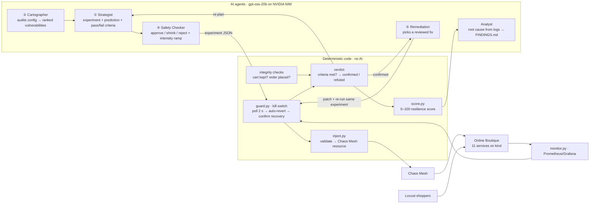

# Architecture overview (one page)

## How the AI makes decisions
1. **Audit before breaking anything.** Code reads every deployment's real configuration (call graph from `*_ADDR` variables, replicas, probes, storage) and computes a risk score. The **Cartographer** judges which combinations are dangerous. **Every fact it cites is checked against the real config**, and unverifiable claims are dropped.
2. **Hypothesis with pre-registered criteria.** The **Strategist** turns each vulnerability into an experiment, predicts the affected services, and writes measurable pass/fail criteria (e.g. `p95_ms > 500`, `integrity_violations > 0`) **before** the run.
3. **Safe execution.** The **Safety Checker** approves, shrinks or rejects (code guarantees it can only make experiments *smaller*), then ramps intensity in steps (e.g. 62 → 125 → 250 → 500 ms) through the guard, recording the highest tolerated level and where our safety limit was crossed.
4. **Verdict by code, not AI.** Integrity checks catch silent failures (HTTP 200 but data lost). Code compares observations with the criteria → **confirmed / refuted**, and computes a 0–100 **resilience score** (errors, latency, recovery, blast radius, integrity). A [scoreboard](evidence/SCOREBOARD.md) recomputes every published score from raw evidence.
5. **Measure likelihood.** `trials.py` repeats an experiment under identical conditions (fault, load, replicas) and reports how often customer thresholds were breached, with a 95% Wilson interval. Failed injections or missing telemetry are kept as *invalid*, never counted as passes. Recovery is timed twice: when capacity is back (service ready) and when customers are back (metrics normal).
6. **Learn and re-plan.** Results go back to the Strategist, which re-ranks the remaining vulnerabilities.
7. **Fix and prove.** For confirmed weaknesses, **Remediation** chooses a fix from a reviewed catalog (it can't write arbitrary patches), applies it after a server-side dry run, **re-runs the identical experiment**, and keeps the fix only if the score improves.
8. **Report.** The **Analyst** explains root causes from error logs captured during each fault (quotes are verified to be real log lines) and writes `FINDINGS.md`, with every number fact-checked against the measured data.

## Safety controls
| Layer | Guarantee |
|---|---|
| Validation | Only 7 known fault types, only real deployments, only namespace `online-boutique`, duration ≤ 120 s, intensity caps |
| AI can't touch the cluster | Agents return JSON only; code validates and acts |
| Only-smaller rule | The Safety Checker can't enlarge or retarget an experiment (enforced in code) |
| Pre-flight | Refuses to inject if the app is unhealthy or another fault is active |
| Kill switch | Polls every 2 s; reverts on error rate > 5%, p95 > 1,000 ms or > 2 unhealthy services (moderate error spikes must persist 2 polls, to avoid false trips from background noise) |
| Fail-safe | Every fault carries Chaos Mesh's own `duration`, so it ends even if the guard crashes (tested with `kill -9`) |
| Always revert | `finally` block on errors and Ctrl-C; scoped manual abort |
| Tighten-only | Runtime limit overrides may only be stricter |
| Remediation allow-list | Only catalogued, reviewed fixes; dry-run first; automatic rollback if the score drops |

**Orchestration:** the stages run as a LangGraph state machine ([diagram generated from the code](WORKFLOW.md)). LangGraph adds a human approval gate before any fix is applied and checkpointing, so an interrupted live run resumes from its last finished step. It stays model-agnostic: nodes call our own `llm.py` (NVIDIA NIM, gpt-oss-20b by default), with no LangChain dependency. We evaluated Google ADK ([design notes](adk/README.md)) and chose LangGraph because our workflow is a code-routed state machine, while ADK is built around model-driven tool calls and Gemini.

**Honest limits:** breaches are detected **~6–10 s after injection**, because Locust reports a rolling ~10 s window. Pod kills are instantaneous and can't be "reverted", only observed until recovery.
