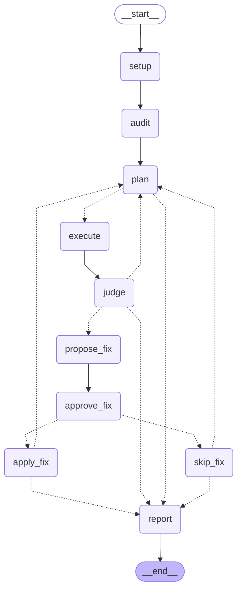

# Agent workflow (LangGraph)

Generated from the real graph with `.venv/bin/python -m chaosmind.graph --draw`; this diagram *is* the code ([chaosmind/graph.py](../chaosmind/graph.py)). Dashed arrows are decisions made by code.

| Node | Agent / code | What happens |
|---|---|---|
| `setup` | `facts.py` (code) | Read the live deployments; load the baseline |
| `audit` | **Cartographer** (AI + verification) | Rank architecture vulnerabilities; drop unverifiable evidence |
| `plan` | **Strategist** (AI + validation) | Experiments, predictions and pass/fail criteria; re-plans with every new result |
| `execute` | **Safety Checker** (AI) → `guard.py` (code) | Approve/shrink/reject, ramp intensity through the kill switch; integrity checks before and after |
| `judge` | code | Verdict against the pre-written criteria; resilience score; stop if cleanup failed |
| `propose_fix` | **Remediation** (AI) | Pick a reviewed fix from the catalog |
| `approve_fix` | **human** (LangGraph interrupt) | Nothing touches the cluster without a yes (`--auto-approve` for recorded runs) |
| `apply_fix` / `skip_fix` | code | Apply, re-run the identical experiment, keep only if the score improves |
| `report` | **Analyst** (AI + fact-check) | `FINDINGS.md` |

**Checkpointing:** every finished node is saved to `runs/agents-…/checkpoints.sqlite`; `--resume runs/agents-…` continues an interrupted run, including one paused at the approval gate.
**Model-agnostic:** nodes call `chaosmind/agents/llm.py` (NVIDIA NIM, gpt-oss-20b by default); no LangChain dependency.
