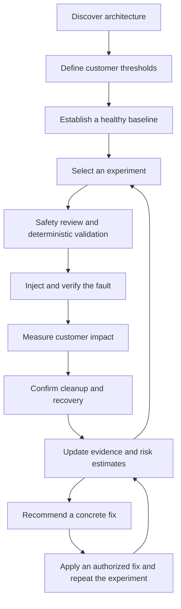

# Google ADK resilience workflow

> **Decision (Day 2):** we implemented this workflow with **LangGraph** instead of ADK (model-agnostic, code-routed, with an approval gate and checkpointing). Every workflow idea below was adopted. See [docs/WORKFLOW.md](../WORKFLOW.md).

This document proposes a Google Agent Development Kit (ADK) workflow for discovering application architecture, running controlled stress and fault experiments, estimating failure likelihood from evidence, and recommending fixes. **This is a design for later implementation, not an implemented ADK integration.**

Build on the existing [agents](../AGENTS.md), architecture collector, incident runners, and deterministic guard. Prioritize reliable measurements and repeatable experiments before adding more agent roles.

## Workflow

Stop when the experiment budget is exhausted, an execution or cleanup failure requires intervention, or the planned questions have been answered. Do not start the next experiment until cleanup and health recovery are confirmed.

## Improvements that matter

| Area | Proposed behavior | Purpose |
|---|---|---|
| Architecture discovery | Read Deployments, StatefulSets, Services, replicas, probes, resource limits, storage, HPA, and disruption budgets. Combine configuration with traces and service metrics. Record evidence, timestamps, and discovery gaps. | Capture actual dependencies and external services without presenting an incomplete graph as complete. |
| Customer impact | Define checkout success, latency, and cart integrity thresholds before testing. | Healthy pods alone do not prove the application works. |
| Baseline | Require fresh telemetry and a stable baseline at the experiment's traffic level and replica count. | Separate fault effects from traffic changes or an already unhealthy application. |
| Experiment selection | Prioritize critical dependencies and unanswered hypotheses. Increase intensity gradually and change one variable at a time. | Each experiment resolves a specific uncertainty. |
| Injection verification | Confirm that the intended fault reached the selected pod; record scope, intensity, and timestamps. | A successful command alone does not prove exposure to a fault. |
| Recovery measurement | Measure traffic impact, replacement readiness, restored capacity, and customer recovery separately. | These are different operational outcomes. |
| Probability estimation | Repeat comparable trials, report uncertainty, and preserve incomplete or aborted outcomes separately. | Avoid treating one successful run or an LLM confidence score as reliability evidence. |
| Remediation | Recommend a specific change with evidence and tradeoffs; repeat the same experiment after applying it. | Demonstrate whether the fix improved resilience. |

The current architecture collector infers calls from `_ADDR` environment variables. Treat these as configured dependencies until runtime evidence confirms them. Absence of a trace also does not prove a dependency does not exist.

## ADK responsibilities

Use ADK to coordinate the workflow and share structured state between stages. A sequential workflow can enforce the initial discovery, planning, review, execution, and reporting order; a bounded orchestration loop can handle repeats and retests.

| Stage | Existing foundation | Proposed responsibility |
|---|---|---|
| Discovery and audit | `chaosmind/agents/facts.py`, `cartographer.py` | Gather facts and generate evidence-backed hypotheses. |
| Experiment planning | `chaosmind/agents/strategist.py` | Choose an allowed fault and write measurable failure criteria before execution. |
| Safety review | `chaosmind/agents/safety.py` | Approve, shrink, or reject a proposal. |
| Execution | `chaosmind/inject.py`, `guard.py`, incident runners | Enforce target, namespace, duration, health limits, cleanup, and recovery in code. |
| Measurement | Monitor, run logs, and integrity checks | Record customer impact, timestamps, resource changes, and data integrity. |
| Analysis and fixes | `analyst.py`, `remediation.py` | Explain findings and propose reviewed fixes with a comparable retest. |
| Evidence store and probability | New work | Group comparable trials and calculate failure frequency and uncertainty. |

Expose narrow tools to the agent rather than unrestricted shell execution. An agent proposal must pass deterministic validation; model reasoning cannot relax the guard. Keep applying fixes an explicit, separately authorized action.

Reference: [Google ADK sequential workflows](https://github.com/google/adk-docs/blob/main/docs/agents/workflow-agents/sequential-agents.md).

## What a probability means

Separate architectural risk from measured failure likelihood:

- **Architectural risk:** A service has one replica and several critical callers. This supports a hypothesis and priority ranking before experiments.
- **Measured failure likelihood:** Under a specified fault, load, configuration, and observation window, a predefined customer threshold was breached in X of N comparable trials.

For example, estimate: “Probability of exceeding the checkout latency threshold when one catalog pod dies at 100 shoppers with two replicas.” Do not turn that into a general probability of a production outage; the experiment does not measure how often that fault occurs in production.

Calculate frequencies and an uncertainty interval in code. Record trial count, failure count, criteria, fault intensity, traffic, replica count, application version, and environment configuration. Group only comparable trials, and account for shared conditions that can make repeats dependent. When evidence is sparse, label it insufficient for a reliable estimate.

Count a confirmed threshold breach even if it triggers early cleanup. Runs with failed injection, missing telemetry, or an unfinished observation window must not silently become successful trials. Preserve their reasons and report the resulting limitations. Never interpret a severity score or an LLM's confidence as a calibrated probability.

## Pod-kill measurements

| Measurement | Question |
|---|---|
| Availability | Did requests or checkouts fail while the pod was gone? |
| Replacement readiness | How long from the recorded injection event until the new pod was observed Ready? |
| Capacity recovery | When was the desired number of ready replicas restored? |
| Customer recovery | When did success rate and latency return to the predefined baseline range? |

Report timestamp sources and sampling precision. A replacement becoming Ready does not establish the exact instant traffic switched to the surviving pod. Measuring that transition requires finer request or connection tracing.

An existing local run on 2026-10-10 killed one of two catalog replicas with 20 shoppers. The replacement was first observed Ready about **2.7 seconds after confirmed injection**. Across the observed preflight-to-recovery interval, counters increased by **146 requests with zero new request or checkout failures**; peak sampled p95 was **91 ms**. At least one catalog pod remained Ready in every recorded pod sample.

Local evidence: `runs/manual-pod-kill-cb0c01b36a-20261010T135610.891870Z/events.jsonl` and `pod-timeline.json`. These files are local run artifacts and are not bundled with this design document. This is one observation, not a measured general failure probability or exact traffic failover time.

## First implementation milestone

1. Discover the catalog's dependencies and capture the current workload configuration.
2. Define request, checkout, latency, and integrity criteria.
3. Establish comparable baselines and repeat catalog pod kills with one replica and with two replicas.
4. Confirm each injection, cleanup, and recovery; retain incomplete runs explicitly.
5. Produce an architecture diagram, experiment conditions, customer impact, recovery timings, failure frequency with uncertainty, and evidence references.
6. Recommend a concrete fix and compare the same experiment before and after it.

Keep the first version focused on this complete learning loop before expanding to all fault types.
