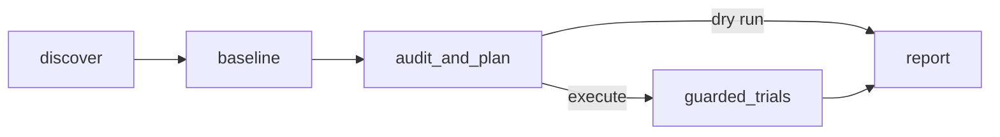

# Portable LangGraph agent: implemented prototype

The new package is `chaosmind.portable`. It has application profiles, an adapter interface, a durable LangGraph workflow, a CLI, and an authenticated HTTP API. The existing Boutique workflow remains the team demo implementation. The bake-off alternative has been retired; the team uses `chaosmind.graph`.



## Run an offline demonstration

```bash
python3 -m venv .venv
.venv/bin/pip install -r requirements-portable.txt
.venv/bin/python -m chaosmind.portable --profile profiles/demo-store.json --execute
.venv/bin/python -m chaosmind.portable --profile profiles/demo-payments.json --execute
```

The two profiles have different workloads and customer journeys. Both exercise the same graph. Offline execution generates **simulated evidence**, with `measured_probability` and its confidence interval set to null. No cluster or model key is needed. Reports and checkpoints are stored in `.runtime/portable-runs/<run-id>/`.

Default model mode is deterministic `rules`. To enable AI planning, configure the profile:

```json
{"adapter":"chat_completions","base_url":"https://your-provider.example/v1","model":"your-model","api_key_env":"MODEL_API_KEY"}
```

This uses a JSON-capable Chat Completions interface. The API key is resolved from the server environment and is never written to checkpoints. Other model protocols can be added behind the planning interface. Provider connectivity and quality need a real run with the selected provider; rules mode is not an AI model.

## Application profile

Configure the namespace, context, allowed workload names, allowed fault types, expected shopper count, customer journey and thresholds. For Kubernetes discovery, install `kubectl` and supply credentials through `kubeconfig` or a mounted service account configuration. Chaos Mesh must already be installed. The process requires read access to workloads, pods, Services, PDBs and HPAs, and tightly scoped access to PodChaos/NetworkChaos resources for execution.

`profiles/kubernetes-example.json.example` is a template; edit it before use. Queries must return **one numeric series each**:

| Key | Unit |
|---|---|
| `error_rate` | Fraction, 0–1 |
| `p95_ms` | Milliseconds |
| `rps` | Requests per second, greater than zero |
| `users` | Current shoppers; must match the profile |
| `source_age_s` | Age of source measurements, seconds |
| `integrity_violations` (optional) | Failed business invariants, integer |

Configure source freshness from the exporter data timestamp, not only `up`. For the existing Boutique exporter, `max(boutique_locust_stats_age_seconds)` supplies source age. Missing, stale, nonnumeric or ambiguous telemetry prevents injection. Integrity checks are only available if the application supplies that metric; absence does not demonstrate data integrity.

Traffic must already be running at `expected_users`. This prototype does not provision a load generator or automatically execute traffic spikes. Supported fault adapters are one-pod kill, network delay and packet loss. Model proposals are checked against server-side target, fault, duration and intensity bounds before use.

Live execution additionally requires `CHAOSMIND_ALLOW_EXECUTION=true`. This is an experimental generic executor, **not the team's live-verified `guard.run` implementation**. The bakeoff uses the contract-compatible dry-run candidate and existing guard functions, not this generic executor. Validate any new application connector in a disposable environment before live use.

## HTTP service

```bash
export CHAOSMIND_API_TOKEN="$(python3 -c 'import secrets; print(secrets.token_urlsafe(32))')"
export CHAOSMIND_PROFILES="$PWD/profiles"
export CHAOSMIND_DATA="$PWD/.runtime/portable-runs"
.venv/bin/uvicorn chaosmind.portable.api:create_app --factory --host 127.0.0.1 --port 8080 --workers 1
```

Use the bearer token on every endpoint except `/health`. The server registers profiles at startup; clients can select only registered application IDs, not submit arbitrary cluster credentials, namespaces, commands or model endpoints.

```bash
curl -H "Authorization: Bearer $CHAOSMIND_API_TOKEN" \
  -H 'Content-Type: application/json' http://127.0.0.1:8080/runs \
  -d '{"application_id":"demo-store","mode":"execute","trials":3}'
```

| Endpoint | Action |
|---|---|
| `GET /applications` | List registered application IDs |
| `POST /runs` | Start a dry run or bounded execution |
| `GET /runs/{id}` | Status and report |
| `GET /runs/{id}/events?after=0` | Progress events with cursors |
| `POST /runs/{id}/cancel` | Request cancellation and cleanup |
| `POST /runs/{id}/resume` | Resume an interrupted or failed run |
| `POST /runs/{id}/recover` | Reconcile pending faults without injection |
| `GET /docs` | OpenAPI documentation |

The CLI also supports `--resume <id>` and `--recover <id>`. Recovery only reconciles owned resources; it never injects. Interrupted operations become invalid trials instead of being blindly repeated. A cleanup failure retains the application lock until recovery succeeds. Each completed trial is journaled before the graph checkpoint, protecting against replay after worker interruption. Run the service as a **single process and single worker** with persistent local storage. This is not a distributed or multi-tenant service; add a durable queue, shared locks, tenant-specific credentials and authorization before exposing it to multiple organizations. Serve external access through HTTPS.

## Container

```bash
podman build -f deploy/portable/Dockerfile -t chaosmind-portable .
podman volume create chaosmind-data
podman run --rm -p 127.0.0.1:8080:8080 \
  -e CHAOSMIND_API_TOKEN -v chaosmind-data:/data \
  chaosmind-portable
```

The image runs as a nonroot user and includes offline profiles. For Kubernetes use, provide a compatible `kubectl` executable and mount operator-owned profiles and credentials read-only; the base image does not bundle `kubectl`. Do not bake secrets into the image.

## Probability and remediation

Repeated, valid trials report the observed customer-threshold breach frequency and a Wilson 95% interval. Conditions include the application configuration fingerprint, experiment parameters, traffic level, journey and thresholds. No valid trials means no estimate. Fewer than three valid live trials is labeled insufficient. Guard trips stop subsequent trials and introduce stopping bias; short trials and correlated measurements limit interpretation. These numbers are **not a forecast of production outage probability**.

Fix recommendations are reviewable text, not automatically applied patches. The current prototype does not remeasure an automatically deployed fix. Kubernetes dependencies are inferred from direct environment references to discovered Services; traces, config files and runtime dependencies are not yet discovered.

## agents.ai

The package can be hosted as an HTTP service independently of any model provider or agent platform. The public agents.ai site currently describes a Chrome extension, and a custom-agent hosting/action contract has not been verified. Native agents.ai deployment is therefore **not implemented or promised**. Once the platform's supported interface is available, connect it to this API without changing the graph.

## Verification

```bash
.venv/bin/python -m unittest discover -s tests/portable -v
```

Verification passed 21 new tests and 47 existing regression tests. Tests cover two distinct applications, no-injection dry runs, traffic validation, fault bounds, guard cleanup, recovery locks, operation replay, conditional statistics and authenticated API execution. Read-only Kubernetes discovery was also checked against the local cluster: 12 workloads and 16 inferred dependency references, with two catalog replicas Ready. No live faults were injected during this implementation verification.
