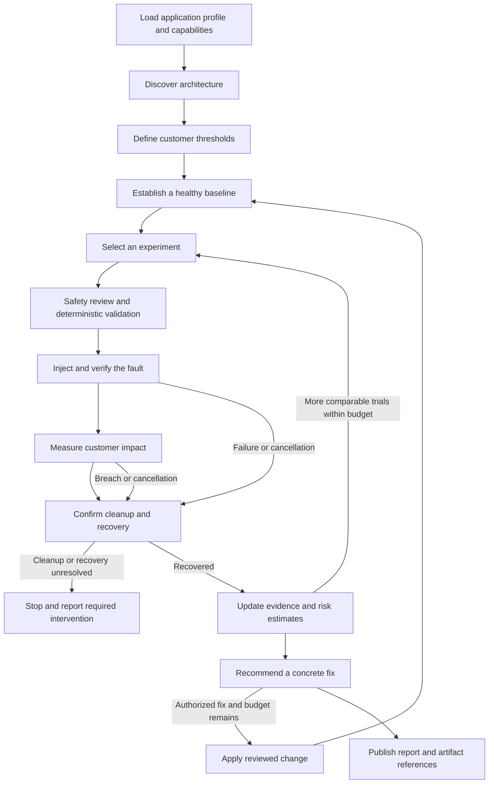
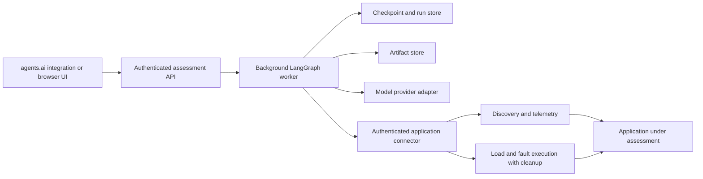

# Portable resilience agent with LangGraph

**Implementation:** [Portable agent usage and limits](PORTABLE.md).

This document proposes a LangGraph workflow for discovering application architecture, running controlled stress and fault experiments, estimating failure likelihood from evidence, and recommending fixes. **The latest repository already has a LangGraph workflow** in `chaosmind/graph.py`, with SQLite checkpoints and a remediation approval gate; see the [implemented workflow](../WORKFLOW.md). This document designs the remaining application portability, hosted API, connector, and agents.ai integration. Those deployment capabilities remain future work. It supersedes the Google ADK proposal.

Build on the existing [agents](../AGENTS.md), architecture collector, incident runners, and deterministic guard. Prioritize reliable measurements and repeatable experiments before adding more agent roles.

## End goal: agents.ai

The end goal is a packaged resilience agent usable through **agents.ai**, with application configuration supplied at onboarding. Users should be able to select an application, request an assessment, follow progress, cancel a run, and receive an architecture map and evidence-backed recommendations.

Deployment compatibility is an open requirement. As checked on 2026-10-10, [agents.ai's public site](https://agents.ai/) describes an invite-only Chrome extension for browser automation. Public documentation establishing custom Python/container hosting or a LangGraph deployment interface was not found. Direct deployment there is **unverified**; a confirmed platform requirement is needed before promising a deploy button or upload format.

Package the core as a portable container with an authenticated HTTPS API and a small browser UI. If agents.ai supports external HTTP actions, add an adapter to that interface. If browser interaction is its supported path, assess a UI integration through its documented flow capabilities. If it offers custom hosting, adapt the package to those runtime requirements. These integration paths remain conditional until verified against the platform.

## What agnostic means

| Dimension | Design decision |
|---|---|
| Model provider | A model adapter returns validated structured output. Provider and model are configuration, with no Google, OpenAI, or Mistral requirement in the graph. |
| Application | Discover arbitrary workloads and dependency graphs. Customer journeys and thresholds are supplied by the user or proposed for review; checkout is one example. |
| Infrastructure | Separate discovery, telemetry, load generation, and fault execution behind capability interfaces. Kubernetes and Chaos Mesh are initial adapters. |
| Hosting | Package the graph as a Python library and API service in an OCI container. Hosting-platform adapters use the same contract. |
| Telemetry | Normalize metrics, logs, traces, and measurements into a common evidence format. |
| Remediation | Describe fixes in portable terms and generate platform-specific patches through reviewed adapters. |

LangGraph is the chosen orchestration framework. Provider and hosting portability come from these boundaries; changing frameworks alone does not make the current code agnostic. Report unknown capabilities rather than assuming the Online Boutique configuration applies to every application.

## Workflow

Stop when the experiment budget is exhausted, an execution or cleanup failure requires intervention, or the planned questions have been answered. Do not start the next experiment until cleanup and health recovery are confirmed.

## Improvements that matter

| Area | Proposed behavior | Purpose |
|---|---|---|
| Architecture discovery | Read Deployments, StatefulSets, Services, replicas, probes, resource limits, storage, HPA, and disruption budgets. Combine configuration with traces and service metrics. Record evidence, timestamps, and discovery gaps. | Capture actual dependencies and external services without presenting an incomplete graph as complete. |
| Customer impact | Define checkout success, latency, and cart integrity thresholds before testing. | Healthy pods alone do not prove the application works. |
| Baseline | Require fresh telemetry and a stable baseline at the experiment's traffic level and replica count. | Separate fault effects from traffic changes or an already unhealthy application. |
| Experiment selection | Prioritize critical dependencies and unanswered hypotheses. Increase intensity gradually and change one variable at a time. | Each experiment resolves a specific uncertainty. |
| Injection verification | Confirm that the intended fault reached the selected pod; record scope, intensity, and timestamps. | A successful command alone does not prove exposure to a fault. |
| Recovery measurement | Measure traffic impact, replacement readiness, restored capacity, and customer recovery separately. | These are different operational outcomes. |
| Probability estimation | Repeat comparable trials, report uncertainty, and preserve incomplete or aborted outcomes separately. | Avoid treating one successful run or an LLM confidence score as reliability evidence. |
| Remediation | Recommend a specific change with evidence and tradeoffs; repeat the same experiment after applying it. | Demonstrate whether the fix improved resilience. |

The current architecture collector infers calls from `_ADDR` environment variables. Treat these as configured dependencies until runtime evidence confirms them. Absence of a trace also does not prove a dependency does not exist.

## LangGraph responsibilities

Build on the existing LangGraph nodes, conditional edges, and SQLite checkpointer, extending their state and persistence for hosted assessments. LangGraph supports mixing deterministic steps with model reasoning and does not require LangChain model components. References: [LangGraph overview](https://docs.langchain.com/oss/python/langgraph/overview), [persistence](https://docs.langchain.com/oss/python/langgraph/persistence).

Graph state should contain an application ID, run ID, capability inventory, versioned topology, baseline reference, predeclared criteria, experiment plan, active fault IDs, trial outcomes, remaining budget, cancellation state, authorization scope, and artifact references. Keep large telemetry files in an artifact store. Resolve secret references at execution time.

| Stage | Existing foundation | Proposed responsibility |
|---|---|---|
| Discovery and audit | `chaosmind/agents/facts.py`, `cartographer.py` | Gather facts and generate evidence-backed hypotheses. |
| Experiment planning | `chaosmind/agents/strategist.py` | Choose an allowed fault and write measurable failure criteria before execution. |
| Safety review | `chaosmind/agents/safety.py` | Approve, shrink, or reject a proposal. |
| Execution | `chaosmind/inject.py`, `guard.py`, incident runners | Enforce target, namespace, duration, health limits, cleanup, and recovery in code. |
| Measurement | Monitor, run logs, and integrity checks | Record customer impact, timestamps, resource changes, and data integrity. |
| Analysis and fixes | `analyst.py`, `remediation.py` | Explain findings and propose reviewed fixes with a comparable retest. |
| Evidence store and probability | `chaosmind/agents/trials.py` and new work | Review its validity/grouping rules, then expose comparable trial frequency and uncertainty through the portable contract. |

Expose narrow tools to the agent rather than unrestricted shell execution. An agent proposal must pass deterministic validation; model reasoning cannot relax the guard. Keep applying fixes an explicit, separately authorized action.

## Reliable execution

Checkpointing does not by itself make fault injection safe to replay. Every mutating request needs a stable operation ID. The execution adapter must reconcile that ID with existing jobs or faults before retrying and return an existing operation when appropriate. Resuming the workflow must not kill a second pod or launch a second load job accidentally.

Enforce one active experiment per application with a lease or lock. Put fault expiration, cleanup, and emergency cancellation in the execution layer so they still work if the graph worker or hosted service stops. A cancellation request must lead through cleanup and recovery checks before a run is marked finished.

Validate graph state and tool inputs at execution boundaries. Model output can propose an action; deterministic code enforces the user's scope, target, duration, intensity, execution budget, health limits, and reviewed remediation actions.

## Portable deployment architecture

The hosted agent needs an application connector with authorized network access to the target environment. A local kind cluster and its kubeconfig cannot automatically be reached from an external platform. For private environments, deploy a connector near the application with an authenticated outbound channel or private network connection. Scope execution credentials to the approved environment and operations.

The Kubernetes/Chaos Mesh adapter can initially reuse the existing runner, but must replace its fixed namespace, kind context, service names, local filesystem assumptions, and host-only shell dependencies with an application profile and execution contract. Configuration should include journey definitions, telemetry sources, supported faults, allowed targets, traffic bounds, and artifact destinations.

Run LangGraph inside a custom API/worker container as the portable default. Keep the graph importable independently of the API and of any particular hosting service. Select production persistence, worker scheduling, model connections, and observability through configuration.

Proposed API contract, independent of any confirmed agents.ai interface:

| Endpoint | Behavior |
|---|---|
| `POST /v1/assessments` | Validate the application profile and execution authorization, enqueue a run, and return a run ID. |
| `GET /v1/assessments/{id}` | Return status, current stage, evidence gaps, and experiment progress. |
| `GET /v1/assessments/{id}/events` | Stream progress events or provide a cursor for polling. |
| `POST /v1/assessments/{id}/cancel` | Request cancellation and cleanup; expose progress until recovery is verified. |
| `GET /v1/assessments/{id}/report` | Return structured findings and Markdown/artifact links. |
| `GET /healthz` | Report service health for the hosting runtime. |

Use short HTTP requests and background jobs because assessments can take minutes. Authenticate callers, isolate application/run data, and persist state across worker restarts. Document schemas and the credential mechanism in OpenAPI so platform adapters can be implemented without changing the graph.

## What a probability means

Separate architectural risk from measured failure likelihood:

- **Architectural risk:** A service has one replica and several critical callers. This supports a hypothesis and priority ranking before experiments.
- **Measured failure likelihood:** Under a specified fault, load, configuration, and observation window, a predefined customer threshold was breached in X of N comparable trials.

For example, estimate: “Probability of exceeding the checkout latency threshold when one catalog pod dies at 100 shoppers with two replicas.” Do not turn that into a general probability of a production outage; the experiment does not measure how often that fault occurs in production.

Calculate frequencies and an uncertainty interval in code. Record trial count, failure count, criteria, fault intensity, traffic, replica count, application version, and environment configuration. Group only comparable trials, and account for shared conditions that can make repeats dependent. When evidence is sparse, label it insufficient for a reliable estimate.

Count a confirmed threshold breach even if it triggers early cleanup. Runs with failed injection, missing telemetry, or an unfinished observation window must not silently become successful trials. Preserve their reasons and report the resulting limitations. Never interpret a severity score or an LLM's confidence as a calibrated probability.

## Pod-kill measurements

| Measurement | Question |
|---|---|
| Availability | Did requests or checkouts fail while the pod was gone? |
| Replacement readiness | How long from the recorded injection event until the new pod was observed Ready? |
| Capacity recovery | When was the desired number of ready replicas restored? |
| Customer recovery | When did success rate and latency return to the predefined baseline range? |

Report timestamp sources and sampling precision. A replacement becoming Ready does not establish the exact instant traffic switched to the surviving pod. Measuring that transition requires finer request or connection tracing.

An existing local run on 2026-10-10 killed one of two catalog replicas with 20 shoppers. The replacement was first observed Ready about **2.7 seconds after confirmed injection**. Across the observed preflight-to-recovery interval, counters increased by **146 requests with zero new request or checkout failures**; peak sampled p95 was **91 ms**. At least one catalog pod remained Ready in every recorded pod sample.

Local evidence: `runs/manual-pod-kill-cb0c01b36a-20261010T135610.891870Z/events.jsonl` and `pod-timeline.json`. These files are local run artifacts and are not bundled with this design document. This is one observation, not a measured general failure probability or exact traffic failover time.

## Implementation milestones and acceptance criteria

1. **Portable core:** extend the existing LangGraph typed state with application profiles and adapter interfaces. Demonstrate the same graph with an offline adapter and a Kubernetes adapter without application-specific names in orchestration.
2. **Complete experiment loop:** discover an application, define customer thresholds, establish a baseline, verify one fault, measure impact, clean up, and report recovery. Demonstrate restart and cancellation without duplicate injection.
3. **Evidence and fixes:** repeat comparable trials, show breach frequency with uncertainty, recommend a concrete fix, and repeat the same experiment after an authorized change.
4. **Deployable service:** package the API and worker, document configuration and OpenAPI, and verify persistence, connector access, and tenant isolation on an external host.
5. **agents.ai integration:** obtain its supported deployment/action interface, implement an adapter, and demonstrate assessment creation, progress, cancellation, and report retrieval from that platform. This milestone requires an actual integration run.

The first experiment can use catalog pod kills with one and two replicas, but the orchestration must also accept another application through configuration. Keep the first version focused on a complete learning loop before expanding to all fault types.
