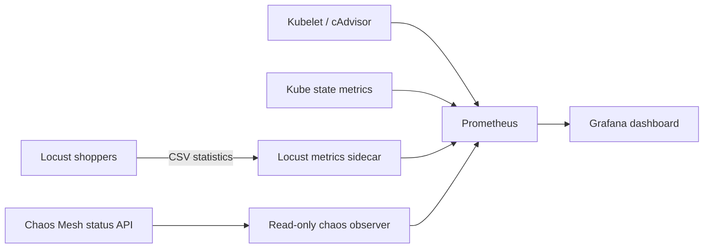

# See what is happening with Prometheus and Grafana

This adds a dashboard that connects shopper traffic, confirmed faults,
application behavior, and Kubernetes health on the existing kind cluster.

## Install and open

From the project folder in your regular host terminal:

```bash
bash scripts/install-monitoring.sh
```

Helm installation does not require sudo. On Linux, the installer checks host
inotify limits; raising them when necessary requires the sudo commands below.
The installer reuses or downloads verified
workspace-local Helm, then installs the pinned
[kube-prometheus-stack 92.3.0 chart](https://github.com/prometheus-community/helm-charts/releases/tag/kube-prometheus-stack-92.3.0).
It requires the existing kind application and Chaos Mesh installation. It
refuses to proceed if unrecovered experiments are present.

Installation adds a metrics sidecar to the loadgenerator and rolls its pod.
**Live Locust counters reset during that rollout.** Existing CSV evidence under
`runs/` is preserved. Do not install during a baseline or fault experiment.
The loadgenerator's replica count is preserved; this does not start shoppers
if they were stopped.

Start the Grafana connection and keep that terminal open:

```bash
bash scripts/monitoring.sh grafana
```

Open [Grafana](http://127.0.0.1:3000/d/boutique-chaos/online-boutique-chaos-overview).
Username: **admin**. Obtain the generated password in a different terminal:

```bash
bash scripts/monitoring.sh password
```

The dashboard is **Online Boutique — Chaos Overview**. If the direct link does
not load immediately, wait for provisioning and find it under Dashboards.
Use **Last 15 minutes** or **Last 30 minutes** and a **5-second refresh**.
Dashboard times use your browser's timezone; experiment CSVs use UTC.

## Read the dashboard in this order

1. **Telemetry availability:** 1 means current measurements are available.
   Zero or No data means investigate collection before interpreting results.
2. **Active shoppers and RPS:** confirm load is running. Twenty users means
   twenty concurrent shoppers, not twenty requests per second.
3. **Confirmed injected faults:** see whether Chaos Mesh actually injected the
   selected experiment. A created resource or Selected condition alone is not
   counted as confirmed injection.
4. **Errors, checkout success, and latency:** these describe shopper impact.
5. **Deployment availability, CPU, memory, and restarts:** these help explain
   which pods were affected and whether they have recovered.

| Panel | Meaning | How to use it |
| --- | --- | --- |
| Active shoppers | Current Locust users | Zero means no simulated shoppers; No data can mean a stopped pod or unavailable exporter. |
| Requests/second | Recent completed throughput | Faults can reduce throughput even while shopper count stays constant. |
| Recent error rate | Recent failed/completed requests | The current guard limit is 5%; the guard trips above it. |
| Recent p95 latency | Recent aggregate request latency estimate | A 1,000 ms value means approximately 95% completed within one second; the guard trips above 1,000 ms. |
| Checkout success (2 min) | Successful checkout fraction over two minutes | No data when no checkouts completed; a successful response still cannot establish that carts were preserved. |
| Confirmed injected faults | Injected PodChaos/NetworkChaos/StressChaos count | Fault count can reach zero before pod health recovers. |
| Chaos status by experiment | Selected, Injected, and Recovered conditions over time | Align confirmed injection with error/latency changes; selection alone can coexist with failed injection. |
| Missing available replicas | Desired minus available deployment replicas | Positive means a deployment has an availability gap. |
| CPU usage by pod | Actual CPU cores used | 0.1 means one tenth of a core. Watch which pod rises during CPU stress. |
| Memory working set | Working-set bytes per pod | Watch sustained growth; this is not a complete memory diagnosis. |
| New restarts (5 min) | Container restart increases | Historical restart totals are different; replacing a pod may create a new series without a counter increase. |
| Failed requests by endpoint | Recent failures by route | Distinguish checkout failures from browsing/cart failures. |

Healthy Kubernetes pods can still return HTTP errors. CPU can stay low during
a network delay. Use the traffic and resource panels together.

The current dashboard thresholds show the approved 5% error and 1,000 ms p95
limits. These are display settings, not a second kill switch. The Python guard
remains responsible for rollback; changing a dashboard does not change it.

## Watch an experiment

### Staged Grafana demonstration

Keep the Grafana port-forward running, select **Last 15 minutes**, and run:

```bash
bash scripts/grafana-stress.sh
```

This records a 60-second phase with 20 shoppers, increases to 100 shoppers
at a spawn rate of 10 per second and observes for 90 seconds, then requests a
500 ms catalog network delay for at most 120 seconds through the existing
Python guard. After guard cleanup and health confirmation, it observes another
60 seconds and returns traffic to 20 shoppers. Rollouts add time to the run.
No further fault is started if the guard refuses or cannot confirm recovery.

Watch Active shoppers, throughput, latency, injected faults, CPU, and errors.
The guard removes the fault above 5% recent errors or 1,000 ms recent p95;
an early rollback is an expected result. A delay can reduce throughput, and
CPU saturation or HTTP errors are not guaranteed at this load. This is a
demonstration of load and fault impact, not a measurement of maximum capacity.

Changing user count rolls the loadgenerator, temporarily interrupting traffic
and resetting its counters. Guard logs provide confirmed injection and rollback
times, so distinguish these rollouts from fault effects. Stage timestamps,
measurement text, and the final high-load CSVs are saved under
`runs/grafana-stress-*`; the guard prints its separate artifact directory.
Returning to 20 shoppers also rolls the loadgenerator. On an interrupted run,
the wrapper attempts to restore 20 shoppers, while guard cleanup is handled by
the guard itself; verify experiment status before starting another run.

The errors chart is fixed to 0–100% so a period with zero errors does not get
an artificial 10,000% vertical scale.

### Individual experiments

### Single catalog pod kill

Once Grafana is stable at 3/3 ready, run in another terminal:

```bash
bash scripts/grafana-pod-kill.sh
```

This starts 100 shoppers, records 60 seconds of baseline, and uses Chaos Mesh
`PodChaos/action: pod-kill` to kill exactly the original catalog pod. Selection
uses its exact name so the replacement is not selected for another kill.
Baseline health and approved error/latency limits are checked before injection.
The script records another 120 seconds, checks that a different pod UID is
present and all services/traffic are healthy at the end, removes its experiment,
and returns to 20 shoppers. Changing load rolls Locust and resets its counters.

Watch deployment availability, request errors, throughput and latency. Recovery
can be fast enough that a 15-second Prometheus scrape misses the availability
dip; errors and the saved pod UID evidence can still show the impact. New
container restarts need not rise: Kubernetes replaces the entire pod. A kill
is instantaneous and cannot be undone by the latency/error guard. The test
requests only one kill and relies on the Deployment to create a replacement;
no further faults are requested if recovery fails.

Evidence under `runs/grafana-pod-kill-*` includes `metrics.csv`, raw Locust CSVs,
the selected pod metadata, experiment manifest, Chaos Mesh status, and a result
report when the observation completes. Monitoring errors are recorded as errors,
not successful recovery. Ctrl-C requests cleanup and restoration of 20 shoppers.

First enable shoppers, then allow metrics to accumulate:

```bash
bash scripts/load.sh start 20 2
bash scripts/load.sh measure 5 30
```

Look at the normal dashboard values before injecting. In another terminal:

```bash
bash scripts/chaos.sh start shipping-delay
bash scripts/chaos.sh show shipping-delay
```

Watch the injection line and latency/throughput panels during the 60-second
experiment. Actual impact depends on which shopper requests use shipping.
No spike is guaranteed for every short experiment.

```bash
bash scripts/chaos.sh stop shipping-delay
```

For guarded experiments, use the existing `python3 -m chaosmind.guard ...`
commands. The CSV guard still reads Locust directly; it does not depend on
Prometheus or Grafana being available.

## Where measurements come from



- Prometheus stores collected time series.
- Grafana visualizes them using the provisioned Prometheus datasource.
- kube-state-metrics supplies workload availability and restart counters.
- Kubelet/cAdvisor supplies pod CPU and memory; host node-exporter is disabled
  to avoid host mounts on this rootless kind setup.
- A standard-library Python sidecar reads the existing Locust CSV volume and
  exposes shopper/request/latency measurements on port 9464.
- A read-only observer lists Chaos Mesh resources in `online-boutique` and
  exposes their confirmed status. It cannot create/delete faults.

Locust is scraped every five seconds, chaos status every ten, and standard
cluster targets every fifteen. Very brief events can fall between scrapes.
Chaos observation currently covers PodChaos, NetworkChaos, and StressChaos;
pod-kill may be too brief to appear as an injected interval.

The exporter uses the
[Prometheus text exposition format](https://prometheus.io/docs/instrumenting/exposition_formats/).
CSV metrics older than fifteen seconds are withheld and availability becomes
zero. Missing or partial CSV files are not replaced with healthy zero values.
Recent p50/p95 are gauges from Locust's overlapping recent windows. They are
not request histograms and cannot be combined into a request-level percentile
over an entire Grafana time range.

Prometheus counter-rate panels use a two-minute interval. A request counter
reset on loadgenerator replacement is handled as a counter reset, but a short
initial period is required before enough samples exist to calculate a rate.

## Missing data or failed installation

### Prometheus inotify failure and Grafana sidecar port conflict

If Prometheus's `init-config-reloader` reports `couldn't initialize inotify:
too many open files`, waiting does not fix the exhausted host resources.
The [kind troubleshooting guide](https://kind.sigs.k8s.io/docs/user/known-issues/#pod-errors-due-to-too-many-open-files)
recommends raising both inotify limits. From the project folder:

```bash
sudo install -m 0644 monitoring/99-boutique-inotify.conf /etc/sysctl.d/99-boutique-inotify.conf
sudo sysctl --load /etc/sysctl.d/99-boutique-inotify.conf

# Restart only the blocked Prometheus pod to clear its retry backoff.
kubectl --kubeconfig .runtime/kubeconfig --context kind-online-boutique \
  -n monitoring delete pod prometheus-boutique-monitoring-prometheus-0 --ignore-not-found
bash scripts/install-monitoring.sh
bash scripts/monitoring.sh status
```

The StatefulSet recreates the pod with its existing PVC. No cluster recreation
is needed. These settings persist across host reboots.

If a Grafana sidecar reports `OSError: [Errno 98] Address in use`, the committed
values assign distinct health listener ports: datasource 8082 and dashboard
8084. Rerunning the installer applies these settings and rolls Grafana.
The startup probe port settings also keep native sidecar configuration aligned
if that mode is enabled later; regular sidecars use the explicit environment
variables. Expect Grafana **3/3** and Prometheus **2/2** ready.

Restart the Grafana port-forward after its rollout. Select a time range ending
at **now** and allow one or two minutes of successful scraping for rate panels.
Grafana's Prometheus connection errors are expected while Prometheus is down.
Live recovery must be confirmed in the host terminal; the assistant cannot
access this cluster from its restricted shell.

### Scrape and workload checks

If browser access stops with `lost connection to pod`, restart
`bash scripts/monitoring.sh grafana`. The wrapper retries failed connections
up to five times, using the service to select a pod again. Ctrl-C stops it.
Reconnects restore access but do not resolve container crashes.

Collect the underlying evidence with:

```bash
bash scripts/monitoring.sh grafana-diagnostics
```

Check restart counts, last termination reason, readiness/liveness failures,
and current/previous Grafana logs. `OOMKilled` indicates a memory issue;
`Evicted` or node pressure events indicate host resource pressure. A forwarding
error alone cannot establish either cause. Avoid changing resource limits
without checking these diagnostics.

The host diagnostics on October 10 confirmed Grafana's main container was
`OOMKilled` (exit 137) with the original 384 MiB limit. The committed budget is
now a 512 MiB request and 1 GiB limit, with `GOMEMLIMIT=768MiB` to leave headroom
outside the Go heap. Apply it to the existing deployment without restarting
Locust or rerunning the full installer:

```bash
bash scripts/monitoring.sh repair-grafana
bash scripts/monitoring.sh grafana
```

This rolls only Grafana and preserves its PVC. Future Helm installations use
the same budget from `monitoring/values.yaml`. After the rollout, expect 3/3
ready and check that the new pod's restart count stays stable while viewing the
dashboard. The increased budget is a repair to validate under load, not proof
that memory growth cannot recur. If another OOM occurs, collect diagnostics
again and inspect Grafana's memory panel and host capacity before increasing
load further.

```bash
bash scripts/monitoring.sh status
bash scripts/monitoring.sh exporter-logs
```

If the loadgenerator has zero replicas, enable it with `scripts/load.sh start`.
If exporters report stale statistics, check the main container's logs and
whether `/stats/load_stats_history.csv` is being written.

Open Prometheus in a separate terminal:

```bash
bash scripts/monitoring.sh prometheus
```

Visit [Targets](http://127.0.0.1:9090/targets). The custom Locust and chaos
targets should be UP, along with kube-state-metrics and kubelet targets.
UP only means the exporter is reachable; also inspect its availability metric.
Search for `boutique_locust_users` or `boutique_chaos_stats_available` in the
query UI. This distinguishes a scrape/discovery issue from a dashboard issue.

If CPU/memory are missing while request data works, inspect the kubelet/cAdvisor
target; those panels have a different source. Unavailable data remains No data.

If Prometheus or Grafana pods are Pending, check scheduling events and PVCs:

```bash
kubectl --kubeconfig .runtime/kubeconfig --context kind-online-boutique \
  -n monitoring get pods,pvc
kubectl --kubeconfig .runtime/kubeconfig --context kind-online-boutique \
  get storageclass
```

The PVCs use the cluster's default storage class. A standard kind installation
includes a local storage provisioner; a cluster without a default provisioner
needs one before these volumes can bind. Prometheus requests 4 GiB and Grafana
1 GiB. Actual occupied storage grows with usage. The stack also uses additional
CPU/RAM and can change the measured baseline; collect a new baseline after
installation if comparing future experiments.

## Recorded pod kill results — October 10, 2026

Run: [`grafana-pod-kill-1a0c612c9e`](../runs/grafana-pod-kill-1a0c612c9e).
These results come from the saved files, not an inferred Grafana screenshot.
All times in this section are **IST (UTC+05:30)**; raw CSV timestamps use UTC.

### Injection and recovery timeline

Chaos Mesh applied a single `PodChaos` with `action: pod-kill`, `mode: one`,
and an exact pod-name selector for
`productcatalogservice-67849487f4-2x7zg`. Its original UID was
`9972846c-6da2-4ff1-a25b-2f34c641fb02`; the observed replacement UID was
`41b70d4b-a5ad-44f4-8357-9351c350f4a8`.

| Time (IST) | Saved observation |
| --- | --- |
| 14:25:33.9–14:26:31.4 | Baseline samples: shoppers ramped from 50 to 100; mean sampled throughput 23.49 requests/sec, peak recent p95 290 ms, and no unhealthy services. Cumulative failures reached 2 before injection. |
| **14:26:34** | Chaos Mesh recorded `Apply: Succeeded`, `injectedCount: 1`, and `AllInjected: True` for the original catalog pod. |
| 14:26:34.2 | First post-kill sample already contained the replacement UID, but `productcatalogservice` was unhealthy. Cumulative failures were 9. |
| **14:26:36.9** | First sample with no unhealthy deployments. Catalog availability had recovered approximately **3 seconds after injection**. |
| 14:26:34–14:26:55 | History recorded failure count rising from 2 to 68: **66 additional failures** after injection. |
| 14:26:47.3 and 14:26:49.9 | Peak sampled recent aggregate error rate: **25.62%**. |
| 14:26:57.7 and 14:27:00.3 | Peak sampled recent aggregate p95: **10,000 ms (10 seconds)**. |
| **14:27:08.1 onward** | Every remaining sample had healthy deployments and metrics within the approved 5% error / 1,000 ms p95 limits: approximately **34 seconds after injection**. |
| 14:28:31.9 | Last metric sample: 100 shoppers, 22.1 requests/sec, 0% recent errors, 100 ms p95, and no unhealthy services. |

The timing is approximate: samples are spaced roughly 2.6 seconds apart once
collection overhead is included. The sample timestamp is taken before the
Kubernetes/Locust reads finish, and the Chaos timestamp has one-second
resolution. We did not save exact replacement Ready transition timestamps.
Deployment availability is the evidence for readiness recovery here.

### Request failures and latency

The final exported Locust aggregate recorded **4,174 completed requests and
68 failures (1.63%)** across the captured loadgenerator session. This includes
the two failures before the kill; it is not a fault-only error percentage.
All entries in the failure CSV are **HTTP 500 responses**.

| Operation | HTTP 500 failures |
| --- | ---: |
| Checkout (`POST /cart/checkout`) | 16 |
| Add to cart (`POST /cart`) | 9 |
| View cart (`GET /cart`) | 3 |
| Change currency (`POST /setCurrency`) | 6 |
| Homepage (`GET /`) | 3 |
| Product pages combined | 31 |
| **Total** | **68** |

Checkout had **16 failures out of 179 requests (8.94%)**, a whole-session p95
of **12 seconds**, and a maximum response time of approximately **20 seconds**.
These endpoint statistics differ from the recent aggregate latency gauge in
Grafana, which peaked at 10 seconds. The final whole-session aggregate p95 was
150 ms: that summary alone would hide much of the short-lived disruption.

Mean sampled throughput was **23.49 requests/sec during baseline** and
**21.65 requests/sec during the post-kill observation**. Post-kill sampled
throughput ranged from 17.0 to 25.4 requests/sec. Baseline included the shopper
ramp, and this single run does not establish a repeatable capacity reduction.

### Interpretation and limits

**The replacement pod became available before customer-facing traffic fully
recovered.** Failures continued after availability was restored, and delayed
requests/recent metric windows produced later latency and error peaks. This
does not imply the catalog pod remained unavailable for the full 34 seconds.
Service logs were not saved by this demonstration, so the exact internal
failure cause for each request cannot be established from these CSVs alone.

The recent error and p95 peaks exceeded the approved guard thresholds. This
test uses a one-time irreversible pod kill, not the continuous guarded delay
experiment: it checks preflight health, observes recovery, and requests no
additional kills. There was no rollback of the killed pod.

[`result.json`](../runs/grafana-pod-kill-1a0c612c9e/result.json) confirms a
replacement was observed and metrics were healthy at the end.
The saved Chaos status still has `AllRecovered: False`, `phase: Injected`,
and `recoveredCount: 0`: it was captured **before experiment deletion**, and
those Chaos conditions are separate from replacement/application health.
The script requests deletion and restoration of 20 shoppers afterward, but
these artifacts do not independently confirm either completed successfully.

### Evidence files

- [`metrics.csv`](../runs/grafana-pod-kill-1a0c612c9e/metrics.csv): phase, request metrics, unhealthy services, and replacement pod UIDs; 23 baseline and 46 post-kill samples, with no recorded collection errors.
- [`chaos-status.json`](../runs/grafana-pod-kill-1a0c612c9e/chaos-status.json): confirmed successful single injection.
- [`victim.json`](../runs/grafana-pod-kill-1a0c612c9e/victim.json) and [`experiment.json`](../runs/grafana-pod-kill-1a0c612c9e/experiment.json): original pod identity and exact selection/action.
- [`load_stats_history.csv`](../runs/grafana-pod-kill-1a0c612c9e/load_stats_history.csv): counter increments and recent request windows.
- [`load_stats.csv`](../runs/grafana-pod-kill-1a0c612c9e/load_stats.csv) and [`load_failures.csv`](../runs/grafana-pod-kill-1a0c612c9e/load_failures.csv): final endpoint counts, latency percentiles, and HTTP 500 occurrences.

## History, logs, and scope

Prometheus retains up to 24 hours or roughly 2 GB of time-series data, whichever
limit applies first. Prometheus and Grafana use PVCs so ordinary pod restarts
can retain their data. Deleting the kind cluster removes its local stored data.
Historical CSV runs are not imported automatically; monitoring starts when
scraping begins. Grafana dashboards are provisioned from the committed JSON
following [Grafana's provisioning model](https://grafana.com/docs/grafana/latest/administration/provisioning/).

This installation does not add a centralized log store or distributed tracing.
Use `kubectl logs` or saved run CSVs to investigate an HTTP error's cause.
Prometheus/Grafana show when and where a metric changed, but they cannot
recover logs that have already rotated away.

The web interfaces are ClusterIP services accessed through localhost-only
port-forwards. Closing those terminals closes browser access while collection
continues inside the cluster. No app images are rebuilt and no faults are
automatically injected.

## Implementation status

The configuration, exporters, dashboard, and installation/access scripts are
in this checkout. Live installation from this assistant session is blocked by
local Kubernetes socket restrictions. Run the installer in your host terminal
to deploy them. No new implementation tests were added or executed.
